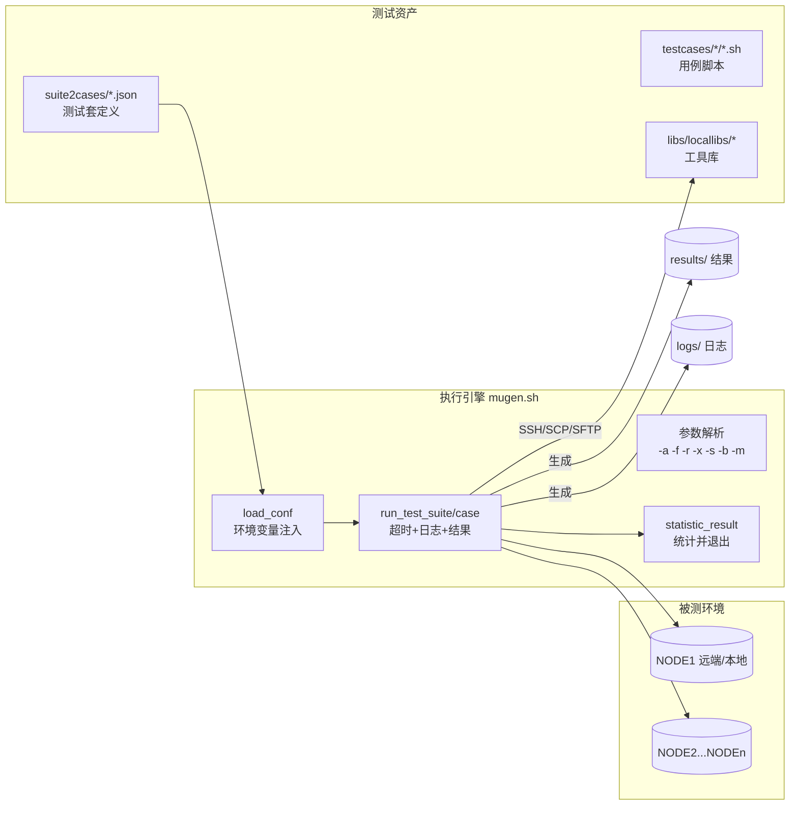
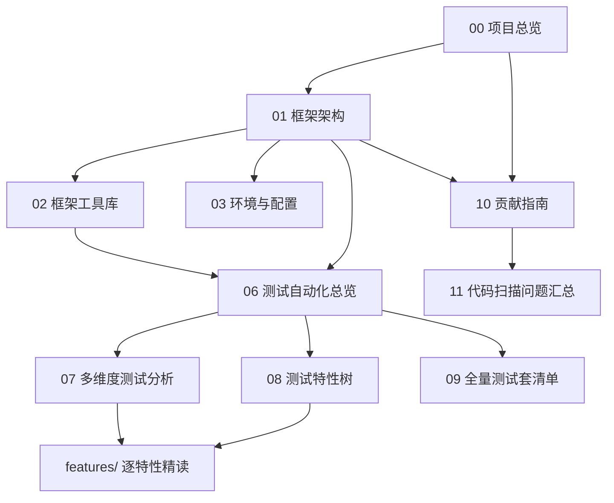

# 00 项目总览

## 1. 项目定位

**mugen**（全称 openEuler Multi-scene Universal aGile testiNg Environment）是 openEuler 社区的开源自动化测试框架。本仓库（`openEuler/mugen`）在框架之外还承载了大量针对 openEuler 操作系统的测试用例，覆盖：

- **软件包/命令行工具测试**（cli-test）：RPM 包的功能、命令、服务测试；
- **冒烟测试**（smoke-test）：OS 基础命令与关键组件的最小化回归；
- **特性测试**（feature-test）：openEuler 自研特性（如 pkgship、oeaware、sysSentry、secscanner 等）；
- **系统级测试**（system-test）：文件系统、网络、存储、内核基础、LTP 等；
- **安全测试**（security_test）：账户/权限/SELinux/证书/加固等；
- **嵌入式测试**（embedded-test）：openEuler Embedded（RISC-V/QEMU/树莓派）场景；
- **文档/指南验证**（doc-test）：对官方管理/开发/安全指南的可操作命令做验证；
- **驱动测试**（driver_test）：以 Excel 用例清单 + 脚本生成 JSON 的方式组织的驱动验证。

> 一句话：**mugen = 一套通用自动化测试引擎 + openEuler 全量 OS 测试用例库**。

## 2. 仓库规模（以代码为准）

数据由仓库扫描脚本统计（2026-10-13）：

| 指标 | 数值 | 说明 |
|------|------|------|
| 顶层目录 | 13 个 | `.agents/.git/.serena/combination/doc/libs/License/suite2cases/testcases` + 根级脚本 |
| suite2cases JSON | **979** | 每个 JSON = 一个测试套定义 |
| 注册用例总数 | **7189** | 含跨套件重复引用（如基线用例被多个版本套件引用） |
| 去重唯一用例 | **6718** | |
| 用例脚本总数（testcases 递归） | **7629** | 含 879 个未被任何套件引用的"孤儿脚本"：**503 个为含 run_test 的可执行用例脚本**（多为 `feature-test/epol/` 下未注册批次），376 个为辅助/公共库 |
| `.sh` 用例 | 7147 | 注册用例中脚本为 `.sh` 的用例数（另 41 例缺脚本）；占 .sh+.py 的 99.99% |
| `.py` 用例 | 1 | 仅模板 `oe_test_casename_02.py` |
| 带 `@Desc` 描述的用例 | 7137 | 描述即测试点概述 |
| 带 `CHECK_RESULT` 断言 | 6461 | 断言式校验 |
| 测试域（分类） | 9 个 | 见下 |

### 测试域（顶层分类）规模

| 测试域 | 套件数 | 注册用例数 | 说明 |
|--------|-------:|-------:|------|
| cli-test | 863 | 4316 | 软件包/命令行/服务 |
| smoke-test | 34 | 734 | OS 冒烟回归（含 `smoke` 全量集合 274 例、`smoke-syscare`） |
| feature-test | 31 | 810 | openEuler 特性 |
| system-test | 28 | 865 | 文件系统/网络/存储/内核等 |
| embedded-test | 15 | 231 | openEuler Embedded |
| doc-test | 6 | 160 | 官方指南验证 |
| security_test | 1 | 71 | 安全加固（实际脚本按 47 个安全主题目录组织） |
| testsuite | 1 | 2 | 框架模板示例 |
| driver_test | — | — | Excel 驱动的驱动用例（未走 suite2cases 注册） |

## 3. 顶层目录结构

```text
mugen/
├── mugen.sh                    # ★ 主执行引擎（框架核心入口）
├── runoet.sh                   # 旧版/简化执行引擎（功能被 mugen.sh 覆盖）
├── combination.sh              # 组合测试入口（转发给 combination.py）
├── qemu_ctl.sh                 # QEMU 嵌入式设备控制入口（转发给 qemu_ctl.py）
├── dep_install.sh              # 框架依赖安装（expect/psmisc/make/iputils/python3-paramiko；-e 装 QEMU）
├── check_casename.py           # 检查套件名/用例名是否重复（不区分大小写）的工具
├── config.json                 # AtomGit 机器人配置（token/owner/repo/baseUrl）
├── suite2cases/                # ★ 979 个测试套定义 JSON（path + cases + 约束）
├── testcases/                  # ★ 用例脚本库（按 9 个测试域分目录）
│   ├── cli-test/               # 841 个包目录
│   ├── smoke-test/
│   ├── feature-test/
│   ├── system-test/
│   ├── embedded-test/
│   ├── security_test/
│   ├── doc-test/
│   ├── driver_test/            # DriverBasics.xlsx / DriverAdvanced.xlsx
│   └── testsuite/              # 模板用例
├── libs/                       # ★ 框架库
│   ├── locallibs/              # 24 个 bash/python 工具模块
│   └── results_listener.sh     # 结果上报监听器（CI 场景）
├── combination/                # 6 个组合测试 JSON（嵌入式版本回归矩阵）
├── doc/                        # 文档（含本学习指南 learning/）
├── conf/                       # 运行时生成的 env.json（已被 .gitignore 忽略）
├── License/                    # Mulan PSL v2 协议
└── .agents/                    # AI Agent 技能（git-flow / PR / 测试执行）
```

## 4. 技术栈

| 层 | 技术 | 用途 |
|----|------|------|
| 执行引擎 | Bash（`#!/usr/bin/bash`） | mugen.sh / runoet.sh / qemu_ctl.sh |
| 工具库 | Python 3 + Bash 双实现 | SSH/SCP/SFTP 等（paramiko/expect） |
| 用例语言 | Bash（99.99%）、Python（模板） | |
| 配置 | JSON（suite2cases / env.json / combination） | |
| 远端通信 | SSH（paramiko）、SCP（expect）、SFTP（paramiko） | |
| 嵌入式 | QEMU（qemu-system-aarch64/arm）、网桥 | |
| 日志 | 自定义 mugen_log（stderr 输出，时间戳+级别） | |

### 关键依赖（dep_install.sh 安装）

- 公共依赖：`expect psmisc make iputils python3-six python3-paramiko`
- QEMU 额外依赖（`-e`）：`bridge-utils qemu-system-aarch64 qemu-system-arm`

## 5. 版本与更新脉络

- 仓库基于 openEuler 社区 mugen 主仓，持续演进（最近提交 `1fedd766d docs(learning): 自动刷新学习文档（数据快照同步上游最新状态）`）。
- 重要演进痕迹（从代码可观测）：
  - `write_conf.py` 注释明确标注 *"TODO 项目中所有的LOCALTION应改为LOCATION"* —— 环境变量体系仍使用 `LOCALTION`（历史拼写保留）。
  - 提供新旧两套引擎：`runoet.sh`（旧）与 `mugen.sh`（新），新引擎支持 `-s` 远端执行、`-b` 编译套件、`-m` 改配置、结果三级目录（succeed/failed/skipped）。
  - 新增 `results_listener.sh` 结果监听（CI 上报）、`check_environment.py`（环境因子预检）、`driver_generate_json.py`（Excel→suite2cases）。

## 6. 框架设计思想（一页读懂）



**核心设计要点：**

1. **配置驱动**：`suite2cases/<套件>.json` 描述"测什么 + 需要什么环境"，脚本目录 + `cases` 列表即测试集；
2. **用例模板化**：用例 = `config_params / pre_test / run_test / post_test` 四段式（可省略段），`main "$@"` 统一收尾；
3. **环境变量化**：`conf/env.json` 注入 `NODE<id>_IPV4/PASSWORD/USER/...` 等环境变量，用例通过变量访问节点，天然支持多机；
4. **双栈工具库**：优先 Python（paramiko），Python 不可用时降级纯 Bash/expect（`common_lib.sh` 自动选择）；
5. **结果即文件**：每个用例以 `results/<套件>/<succeed|failed|skipped>/<用例名>` 空文件标记结果，易被 CI 汇总。

## 7. 新手阅读路线图


