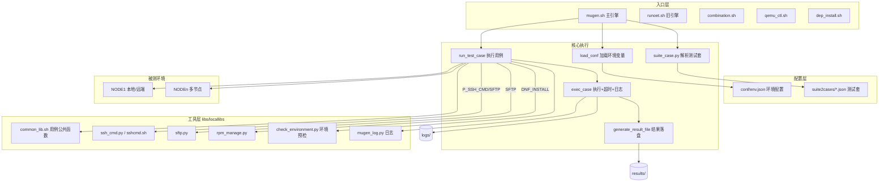
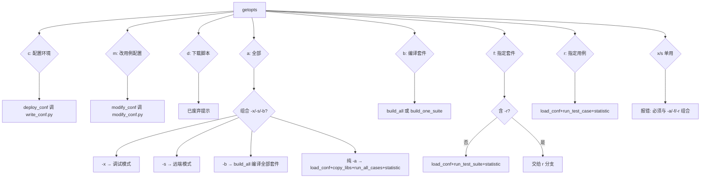
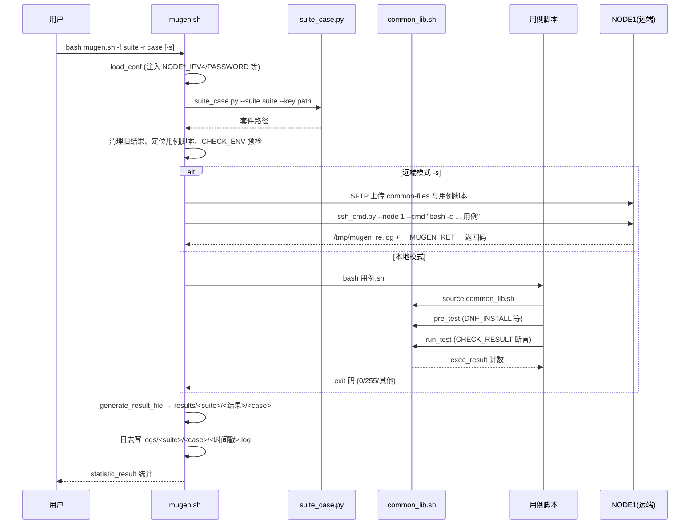
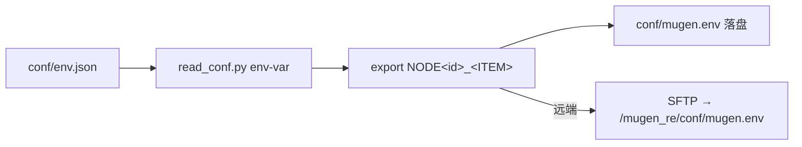

# 01 框架架构（测试框架是怎么样的）

> 本章逐函数分析执行引擎 `mugen.sh`（485 行）与旧引擎 `runoet.sh`（218 行），并给出完整执行流程、结果处理、日志、超时、远端执行机制。**所有内容基于代码**。

## 1. 总体架构



## 2. `mugen.sh` 函数级分解

### 2.1 全局初始化（第 20–42 行）

| 代码 | 说明 |
|------|------|
| `OET_PATH=$(cd $(dirname $0); pwd)` | 固定框架根路径并导出环境变量 `OET_PATH` |
| `source libs/locallibs/common_lib.sh` | 加载用例公共函数库（LOG_*/CHECK_RESULT/SLEEP_WAIT 等） |
| `conf_file` | `/etc/mugen/mugen.json`（系统安装模式）否则 `$OET_PATH/conf/mugen.json` |
| 全局变量 | `TIMEOUT="30m"`（默认超时）、`COMMAND_X/S`（调试/远端开关）、`CASE_NUM/SUCCESS_NUM/FAIL_NUM/SKIP_NUM`（统计） |

### 2.2 函数清单（全部 13 个函数 + 主流程）

| 函数 | 作用 | 关键逻辑 |
|------|------|----------|
| `usage()` | 打印帮助 | 列出 `-c -a -f -r -x -b -s -m` 参数用法 |
| `deploy_conf()` | 部署环境配置 | 调 `write_conf.py "$@"`，失败退出 1 |
| `modify_conf()` | 修改用例配置文件 | 调 `modify_conf.py "$@"` |
| `load_conf()` | 加载环境配置 | ①清空 `results/` ②`read_conf.py env-var` 生成 export 字符串 ③`eval` 注入环境变量 ④写 `conf/mugen.env` ⑤远端模式（`-s`）用 SFTP 上传 `mugen.env` 到 NODE1 的 `/mugen_re/conf/` |
| `generate_result_file(suite,case,exitcode)` | 结果落盘 | exitcode==0→`results/<suite>/succeed/<case>`；==255→`skipped`；否则→`failed`；更新计数 |
| `exec_case(cmd,log_path,case_name,test_suite)` | 执行一条命令并记录 | ①`exec 6>&1/7>&2` 暂存 stdout/stderr ②`exec >>log 2>&1` 重定向 ③`SLEEP_WAIT $TIMEOUT "$cmd"` 带超时执行 ④恢复流 ⑤`143`（超时）时 `pgrep`+`pstree`+kill 残留进程 ⑥`generate_result_file` |
| `run_test_case(test_suite,test_case)` | 运行单个用例 | 见 §3 详细流程 |
| `run_test_suite(test_suite)` | 运行整个测试套 | 校验 JSON 存在 →（远端+COPY_ALL 时整目录 SFTP 上传一次）→ 遍历 `suite_case.py --key cases-name` 输出的每个用例执行 |
| `run_all_cases()` | 运行全部套件 | 遍历 `suite2cases/*.json` 文件名 → `run_test_suite` |
| `statistic_result()` | 输出统计 | 打印总数/成功/失败/跳过数，`exit FAIL_NUM`（有失败则非零退出） |
| `build_one_suite(suite)` | 编译单个套件 | 若套件目录存在 `Makefile/makefile` 则 `make`（支持 SDK 交叉编译环境 `SDK_PATH`） |
| `build_all()` | 编译全部套件 | 遍历全部套件 `build_one_suite`，统计 make 结果 |
| `copy_libs_to_node1()` | 拷贝库到远端 | `-s` 模式下检查 NODE1 的 `/mugen_re/` 是否有 libs，无则 SFTP 上传整个 `libs/` |
| 主流程（getopts 分发） | 顶层参数解析 | `c/a/f/r/d/x/s/b/m` 各选项分支（见 §3） |

### 2.3 `run_test_case` 内部流程（框架最重要函数）

```mermaid
flowchart TD
    A[run_test_case 套件+用例] --> B{参数完整?}
    B -- 否 --> E1[LOG_ERROR 退出1]
    B -- 是 --> C[清理 results/套件 下同名旧结果]
    C --> D[suite_case.py --key path 取套件路径]
    D --> F{路径存在?}
    F -- 否 --> E2[LOG_ERROR 返回1]
    F -- 是 --> G{suite2cases/套件.json 含用例名?}
    G -- 否 --> E3[LOG_ERROR 返回1]
    G -- 是 --> H[find 套件路径下 用例.sh/py 唯一匹配]
    H --> I{多于1个?}
    I -- 是 --> E4[LOG_ERROR 返回1]
    I -- 否 --> J[(CASE_NUM++) 建 logs/套件/用例 目录]
    J --> K{脚本存在?}
    K -- 否 --> L[写日志 + exec_case exit 255 → skipped]
    K -- 是 --> M[CHECK_ENV 环境预检]
    M -- 不满足 --> L
    M -- 满足 --> N{远端且未拷贝?}
    N -- 是 --> O[SFTP 上传 common-files + 用例脚本到 /mugen_re]
    N -- 否/完成 --> P[pushd 用例目录]
    P --> Q[解析 EXECUTE_T 覆盖超时]
    Q --> R{脚本类型}
    R -- sh/bash --> S[bash 或 bash -x]
    R -- py --> T[python3]
    S --> U{远端?}
    U -- 是 --> V[通过 ssh_cmd.py 在 NODE1 上 bash -c 执行, 结果写 /tmp/mugen_re.log 含 __MUGEN_RET__]
    U -- 否 --> W[本地执行]
    T --> U
    V --> X[exec_case]
    W --> X
    X --> Y[popd]
    Y --> Z[LOG_INFO 结束]
```

**`run_test_case` 关键细节（精确到行）：**

- **旧结果清理**（190–193）：`find results/<suite> -name <case>`，存在则删除——支持重跑不残留。
- **套件路径解析**（195）：`suite_case.py --suite <suite> --key path`，路径不存在则报错。
- **用例归属校验**（202）：`grep -q <case> suite2cases/<suite>.json`——用例必须登记在套件 JSON 中才能执行。
- **脚本唯一性**（207–211）：`find <suite_path> -name "<case>.*"` 去掉 `.sh/.py` 后缀取目录；若匹配到多个（重复脚本）直接报错返回。
- **超时覆盖**（258–260）：`grep -w --fixed-strings EXECUTE_T "<case>.*"` 提取 `EXECUTE_T="50m"` 覆盖全局 30m 超时。
- **脚本类型**（262–273）：以 `find . -name "<case>.*" | awk -F. '{print $NF}'` 判定 sh/bash/py。
- **远端执行**（275–288）：
  - 写 `/tmp/mugen_remote_case_name`（供超时后远端进程清理）；
  - `export MUGEN_SSH_NODE=1`；
  - 构造远端命令：`bash -c 'trap "" SIGHUP; . /mugen_re/conf/mugen.env && export OET_PATH=/mugen_re && pushd <case_dir> && <run_cmd> > /tmp/mugen_re.log 2>&1; echo __MUGEN_RET__=$? >> log; cat log; popd; exit $ret'`；
  - 本地再包一层 `python3 libs/locallibs/ssh_cmd.py --node 1 --cmd "..."`。
- **远端清理**（294–297）：执行完删除远端套件目录与临时文件。

### 2.4 `exec_case` 超时与日志细节

- 日志文件：`logs/<suite>/<case>/<YYYY-mm-dd_HH-MM-SS>.log`。
- 超时实现依赖 `SLEEP_WAIT`（`common_lib_python.sh` → `sleep_wait.py`，mode=1 用 `subprocess.Popen` + `communicate(timeout)`）。
- 超时返回码 **143**（`TimeoutExpired` 分支设置）→ `exec_case` 检测到 143 后 `pgrep -f "$cmd"` → `pstree -p` 取全部子进程 PID → `kill -9` 兜底清理。
- 远端模式下 `sleep_wait.py` 还会 `_kill_remote_processes()`：读 `/tmp/mugen_remote_case_name`，用 paramiko SSH 到 NODE1 执行 `pkill -9 -f <case>`。

### 2.5 结果三级目录（`generate_result_file`）

| 退出码 | 结果目录 | 计数 |
|--------|----------|------|
| 0 | `results/<suite>/succeed/` | SUCCESS_NUM++ |
| 255 | `results/<suite>/skipped/` | SKIP_NUM++ |
| 其他 | `results/<suite>/failed/` | FAIL_NUM++ |

> 255 = 环境不满足/脚本缺失（`exec_case "exit 255"`）。`statistic_result` 最后以 `exit $FAIL_NUM` 收尾。

## 3. 参数分发（getopts 主循环）



### 3.1 参数解析实现要点（第 450–574 行）

- 通过 `echo "$@" | grep -q -e '...'` 模式匹配来组合解析（非标准 getopts 的复杂场景），例如：
  - `-a -x` / `-x -a` / `-ax` / `-xa` → 调试模式；
  - `-a -s` / `-s -a` → 远端模式；
  - `-a -b` → 先编译全部再执行（实际分支为 `build_all; exit`）；
- `-f/-r` 的 `-x`/`-s` 检测：`grep ' * -x *\| * -xf *'`（含 `-xf` 连续写法）、`grep ' * -s *\| * -sf *'`。
- `-r` 分支假设前面已有 `-f`（`$test_suite` 复用 getopts 保存值）。
- 非法组合（如 `-b` 后跟其他参数、用例名含保留字）→ `usage` 退出 1。

## 4. `runoet.sh`（旧引擎）差异对照

`runoet.sh` 是简化版旧引擎，核心流程一致，差异如下：

| 维度 | mugen.sh（新） | runoet.sh（旧） |
|------|----------------|-----------------|
| 远端执行 `-s` | ✅ 完整（SFTP 上传、远端日志回收） | ❌ 无 |
| 编译 `-b` | ✅ | ❌ |
| 改配置 `-m` | ✅ | ❌ |
| 结果目录 | 按套件三级目录 | 扁平 `results/succeed|failed` |
| 跳过 255 | ✅ | ❌（非0全算失败） |
| 用例顺序 | JSON 顺序 | `| shuf` 随机打乱 |
| 结果统计退出 | `exit FAIL_NUM` | 有失败 `exit 1` |
| 超时命令 | `SLEEP_WAIT`（自定义轮询） | `timeout --preserve-status`（GNU timeout） |

> `runoet.sh` 还保留 `download_cases()`：`git clone https://gitee.com/openeuler/integration-test.git` 到临时目录并整体拷入 `$OET_PATH`（`-d` 参数）。

## 5. 一个用例的完整生命周期



## 6. 日志系统

- **用例日志**：`LOG_INFO/WARN/DEBUG/ERROR`（bash）或 `mugen_log.py --level`（python）输出到 **stderr**，格式：
  - bash（shell 实现）：`2026-10-13 12:00:00  <脚本> [ INFO ]  <msg>`
  - python 实现：`Wed Oct 13 12:00:00 2026 - INFO  - <msg>`
- **执行日志**：`exec_case` 将用例 stdout/stderr 整体重定向进 `logs/<suite>/<case>/<时间戳>.log`。
- **框架日志**：`LOG_ERROR` 直接在控制台 stderr 打印。

## 7. 环境变量体系（load_conf 产物）



`env.json` 中每个节点的可导出字段（`NODE_ITEM`）：

`LOCALTION, MACHINE, FRAME, USER, PASSWORD, SSH_PORT, NIC, IPV4, IPV6, MAC, HOST_IP, HOST_USER, HOST_PASSWORD, BMC_IP, BMC_USER, BMC_PASSWORD`（+ 可选 `COPY_ALL`）

> 用例内直接引用 `$NODE1_IPV4`、`$NODE1_PASSWORD` 等；`MACHINE==kvm` 跳过 BMC 字段、`physical` 跳过 HOST 字段。

## 8. 关键设计结论（面试/汇报可直接引用）

1. **用例=脚本+登记**：只写脚本不登记到 suite2cases JSON 不会被执行（框架强制校验，`check_casename.py` 亦会做查重）。
2. **结果=退出码**：bash 用例最终 `exit` 码 0/255/其他 分别映射成功/跳过/失败；`CHECK_RESULT` 只是计数 `exec_result`，由 `CASE_RESULT` 在 `main` 中统一 `exit`。
3. **环境=环境变量**：多机能力完全来自 `NODE<id>_*` 环境变量，用例无需感知 IP 细节。
4. **超时三级**：全局 30m → 用例 `EXECUTE_T` 覆盖 → `SLEEP_WAIT` 精确到秒轮询；超时 143 自动杀残留进程（本地 pgrep/pstree + 远端 pkill）。
5. **可组合执行**：`-a -s`、`-f -x`、`-b -a` 等可叠加，满足 CI 全量/调试/预编译需求。
