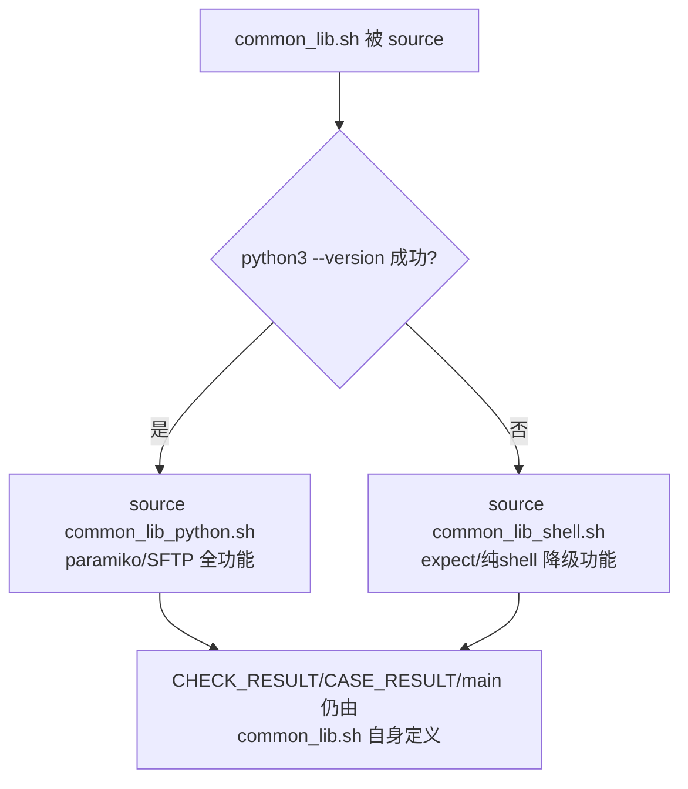
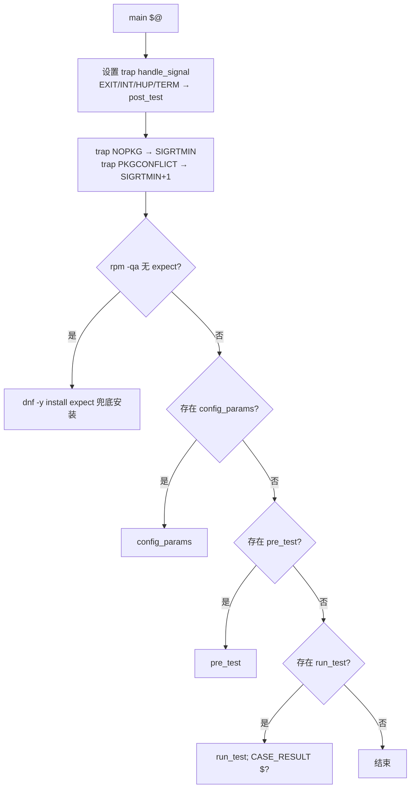
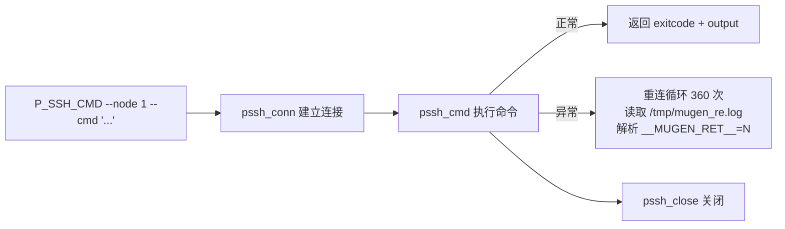
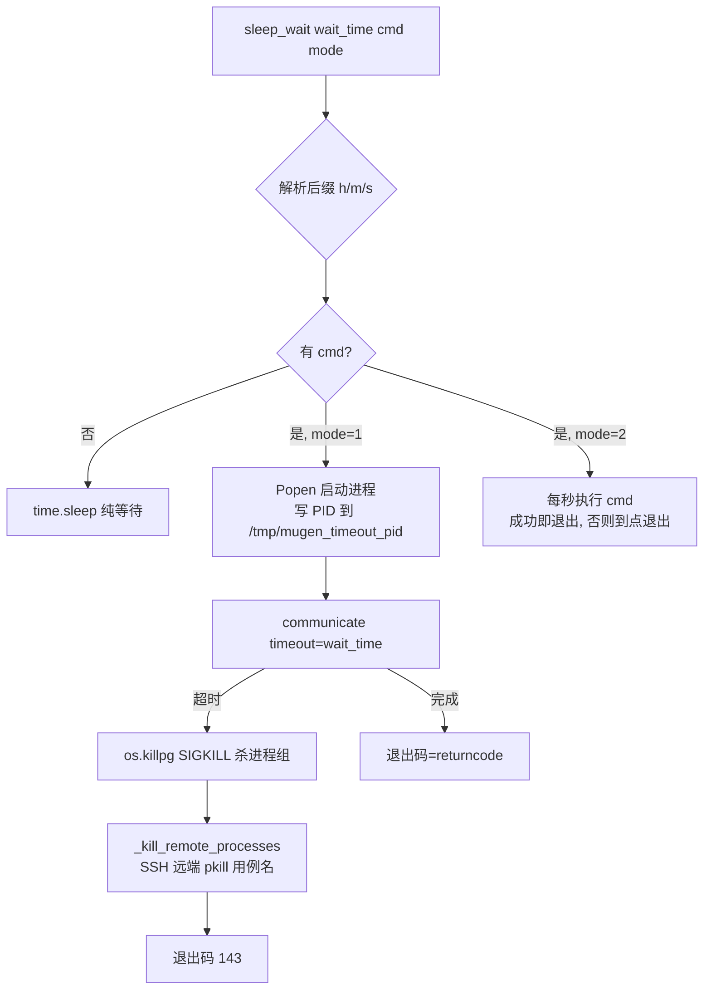
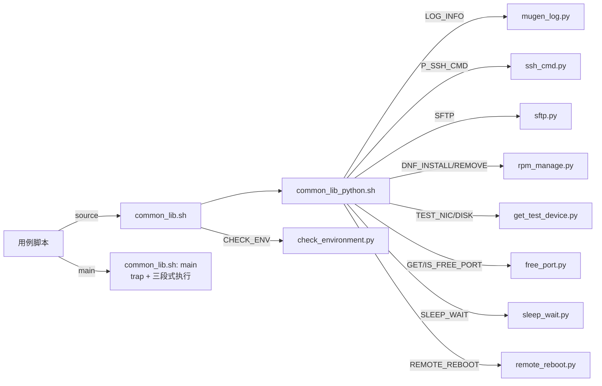

# 02 框架工具库（libs/locallibs 全部模块逐函数分析）

> 本章对 `libs/locallibs/` 下 **24 个模块**（bash 与 python 双实现）以及 `libs/results_listener.sh` 进行逐函数分析，给出每个函数的签名、职责与关键实现。用例脚本通过 `source ${OET_PATH}/libs/locallibs/common_lib.sh` 统一接入。

## 1. 模块总览

| 模块 | 语言 | 行数 | 一句话职责 | 用例侧入口 |
|------|------|-----:|------------|------------|
| common_lib.sh | bash | 127 | **总入口**：按 python3 可用性选择 python/shell 实现，定义 CHECK_RESULT/CASE_RESULT/main | `source` |
| common_lib_python.sh | bash | 175 | **Python 实现**：LOG_*/SSH/SFTP/RPM/端口/重启/超时等用例函数 | `source` |
| common_lib_shell.sh | bash | 334 | **Shell 降级实现**：无 python3 时用 expect 实现 SSH/SCP、yum 装包 | `source` |
| mugen_log.py | python | 54 | 日志输出模板（stderr 写时间戳+级别） | LOG_* |
| ssh_cmd.py | python | 189 | paramiko SSH 远端命令执行（含断线重连取结果） | P_SSH_CMD |
| sshcmd.sh | bash | 136 | expect 封装 ssh 执行远端命令（降级路径） | SSH_CMD |
| sshscp.sh | bash | 108 | expect 封装 scp 文件传输（降级路径） | SSH_SCP |
| sftp.py | python | 267 | SFTP 递归目录/文件上传下载 | SFTP |
| rpm_manage.py | python | 222 | dnf 安装/卸载软件包，记录依赖供回滚 | DNF_INSTALL/DNF_REMOVE |
| suite_case.py | python | 183 | 解析 suite2cases JSON（path/cases-name/common-files） | 框架内部 |
| read_conf.py | python | 159 | 读 env.json 生成 export 环境变量串 / 节点数 / 节点类型 | 框架内部 |
| write_conf.py | python | 223 | **配置环境**：探测目标机信息写入 conf/env.json | mugen.sh -c |
| modify_conf.py | python | 68 | **改用例配置**：sed 替换用例自带配置文件中的键值 | mugen.sh -m |
| check_environment.py | python | 90 | **环境预检**：校验机器数/类型/网卡/磁盘满足用例约束 | 框架内部 CHECK_ENV |
| free_port.py | python | 131 | 随机查找空闲端口 / 检测端口是否被占用 | GET_FREE_PORT/IS_FREE_PORT |
| get_test_device.py | python | 177 | 获取可测试网卡 / 可测试磁盘名（自动装 lshw） | TEST_NIC/TEST_DISK |
| sleep_wait.py | python | 143 | **命令超时控制**：mode1 带超时执行、mode2 轮询成功 | SLEEP_WAIT |
| remote_reboot.py | python | 133 | 远端机器重启 + 等待重启完成 | REMOTE_REBOOT/REMOTE_REBOOT_WAIT |
| qemu_ctl.py | python | 700 | **QEMU 启停控制**：多 QEMU、桥接/USER 网络、ssh 配置 | qemu_ctl.sh |
| combination.py | python | 524 | **组合测试**：解析组合 JSON 生成执行脚本并跑测 | combination.sh |
| driver_generate_json.py | python | 148 | Excel 驱动用例清单 → suite2cases JSON | 驱动测试 |
| configure_repo.sh | bash | 207 | 配置 openEuler yum 软件源（OS/everything/EPOL/update） | 手动 |
| combination_do_clean.sh | bash | 99 | 组合测试后对全部套件执行 make clean | combination.py |
| __init__.py | python | 1 | 包标记 | — |

## 2. 用例公共函数库（common_lib 三件套）

### 2.1 选择机制（common_lib.sh）



> 注：`CHECK_RESULT`、`CASE_RESULT`、`POST_TEST_DEFAULT`、`main` 四个核心函数**只定义在 common_lib.sh**，两个实现文件只提供 LOG/SSH/RPM 等工具函数。无论 python 是否可用，这四个函数都会生效。

### 2.2 `CHECK_RESULT`（断言核心，common_lib.sh 第 26–60 行）

```bash
CHECK_RESULT actual_result [expect_result=0] [mode=0] [error_log=""] [exit_mode=0]
```

| 参数 | 含义 |
|------|------|
| `actual_result` | 实际返回码/实际值（必填） |
| `expect_result` | 期望值，默认 `0` |
| `mode` | 0=实际**!=**期望才算错；1=实际**==**期望才算错（反向断言） |
| `error_log` | 失败时打印的错误信息 |
| `exit_mode` | 1=断言失败立即 `exit 1`；0=仅计数继续跑 |

行为：
1. 参数为空 → `LOG_ERROR "Missing parameter error code."`，`exec_result++`，return 1；
2. mode=0 且实际≠期望 → 打印 error_log、`exec_result++`、打印 `BASH_SOURCE[1] line ${BASH_LINENO[0]}`（**定位断言所在文件与行号**）；exit_mode=1 则直接退出；
3. mode=1 且实际==期望 → 同样处理（用于"预期失败/反向"场景）。

> `exec_result` 是框架贯穿全过程的**失败计数变量**：每次断言失败 +1，最终由 `CASE_RESULT` 决定退出码。

### 2.3 `CASE_RESULT`（用例出口，第 62–81 行）

```bash
CASE_RESULT case_re   # 传入 run_test 的退出码
```

- 无失败计数（`exec_result` 为空）且 `case_re==0` → LOG "succeed"，`exit 0`；
- 无失败计数且 `case_re!=0` → LOG "failed"，`exit case_re`；
- 有失败计数（>0）→ LOG "failed"，`exit exec_result`（**失败数即退出码**）。

### 2.4 `main`（用例统一入口，第 87–127 行）



**关键机制——`handle_signal`（EXIT 陷阱）**：
- 用 `__TRAP_EXECUTED` 标志保证 post_test **只执行一次**；
- 若用例定义了 `post_test` 函数则调用它，否则调用 `POST_TEST_DEFAULT`（只打日志）；
- 收到 `SIGRTMIN`（NOPKG）→ 清理后 `exit 255`（跳过）；收到 `SIGRTMIN+1`（PKGCONFLICT）→ `exit 247`（包冲突）。

> **这个设计意味着：用例的 `post_test` 不一定写在文件末尾，而是通过 EXIT 陷阱在进程结束时自动执行**——因此用例即使中途 `exit`/被 kill，也会走 post_test 清理环境。

### 2.5 Python 实现工具函数（common_lib_python.sh）

| 函数 | 签名 | 实现 |
|------|------|------|
| `LOG_INFO/WARN/DEBUG/ERROR` | `message` | 调 `mugen_log.py --level --message` |
| `SSH_CMD` | `cmd remoteip [remotepasswd] [remoteuser] [timeout] [connport]` | 调 `sshcmd.sh -c/-i/-u/-p/-t/-o`（expect 实现），失败打 ERROR |
| `SSH_SCP` | `src dest [remotepasswd] [connport]` | 调 `sshscp.sh -p/-o/-s/-d` |
| `P_SSH_CMD` | `$@`（透传） | 调 `ssh_cmd.py`（paramiko），**用例推荐用这个** |
| `SFTP` | `$@`（透传） | 调 `sftp.py` |
| `TEST_NIC` | `[node=1]` | 调 `get_test_device.py --device nic --node` |
| `TEST_DISK` | `[node=1]` | 调 `get_test_device.py --device disk --node` |
| `DNF_INSTALL` | `pkgs [node=1]` | 调 `rpm_manage.py install --pkgs --node --tempfile`，**自动把依赖写进全局 `tmpfile`，post_test 用 DNF_REMOVE 回滚** |
| `DNF_REMOVE` | `[node=1] [pkg_list] [mode=0]` | node=0 时对全部节点循环卸载；mode!=0 时先备份再清空 `tmpfile` |
| `GET_FREE_PORT` | `[ip] [start=1000] [end=10000]` | 调 `free_port.py get` |
| `IS_FREE_PORT` | `port [ip]` | 调 `free_port.py check` |
| `REMOTE_REBOOT` | `[node=2] [waittime]` | 调 `remote_reboot.py reboot --node --waittime` |
| `REMOTE_REBOOT_WAIT` | `[node=2] [waittime]` | 调 `remote_reboot.py wait --node --waittime` |
| `SLEEP_WAIT` | `wait_time cmd [mode=1]` | 调 `sleep_wait.py --time --cmd --mode` |
| `CHECK_ENV` | `suite_json test_case` | 调 `check_environment.py --suite_file --case` |

### 2.6 Shell 降级实现差异（common_lib_shell.sh）

仅在 python3 不可用时生效，功能大幅缩减，且存在已知缺陷（详见 11 章问题汇总）：

| 函数 | 实现 | 已知缺陷 |
|------|------|----------|
| `SSH_CMD/SSH_SCP` | 依赖 `expect -v`，否则报错返回 | 无 |
| `P_SSH_CMD/SFTP/TEST_NIC/TEST_DISK` | 直接 `LOG_ERROR` + `exit 1` | **不可用占位** |
| `DNF_INSTALL/DNF_REMOVE` | 用 `$[ "NODE"$node"_LOCATION" ]` 取位置 | ① `$[...]` 是废弃算术展开，其中 `NODE1_LOCATION` 被当作**算术表达式中的变量名**求值（未定义→0），无法做间接变量引用，`location` 恒为 0，local 分支永不命中（且实际环境变量名是 `LOCALTION`，双错位）；② `if ! dnf -y install ...` 重复安装；③ `ret=SSH_CMD ...` 缺 `$()` 命令替换，`ret` 为字面量 `SSH_CMD`；④ `[ ret -ne 0 ]` 比较的是字面量 |
| `IS_FREE_PORT/GET_FREE_PORT` | netstat/随机数+expr | ① `GET_FREE_PORT` 的 `for i in seq 100` 是字面量（不会循环 100 次）；② `check=IS_FREE_PORT new_port` 缺 `$()`；③ 返回 `$new_port`（0–255 限制） |
| `SLEEP_WAIT` | 解析 `m/h/s` 后缀 + 每秒轮询 | `if $cmd` 直接执行命令字符串，语义与 python 版不同 |
| `REMOTE_REBOOT_WAIT` | ping + SSH_CMD 轮询 | — |
| `REMOTE_REBOOT` | SSH_CMD reboot 后调 REMOTE_REBOOT_WAIT | **`$waitetime` 拼写错误**（应为 `$waittime`）→ 传参恒为空 |

> 结论：**生产环境必须安装 python3**（mugen 默认如此），降级路径仅作兼容存在。

## 3. 远程执行三件套

### 3.1 `ssh_cmd.py`（paramiko SSH 执行）



| 函数 | 职责 |
|------|------|
| `pssh_conn(ip,password,port=22,user=root,timeout=None,log_level="error")` | paramiko 连接；`BadAuthenticationType` 时走 `auth_interactive`（键盘交互认证）；连接失败返回 **519** 哨兵值 |
| `pssh_cmd(conn,cmd)` | ①命令前拼接 `export PATH=...` 保证 PATH 完整；②正常执行返回 `(exitcode, output)`，非 0 时合并 stderr+stdout；③执行异常则**每 10s 重连一次、最多 360 次**，读取远端 `/tmp/mugen_re.log` 中 `__MUGEN_RET__=` 行作为退出码 |
| `pssh_close(conn)` | conn!=519 时关闭连接 |

> CLI：`--cmd`（必填）`--node`(默认2) `--ip/--password/--port/--user/--timeout`。指定 `--node` 时自动从 `NODE<node>_IPV4/PASSWORD/SSH_PORT/USER` 环境变量取连接信息——**这是 mugen.sh 远端执行的核心**。

### 3.2 `sshcmd.sh`（expect 降级实现）

`sshcmd() cmd remoteip remotepasswd remoteuser timeout connport`：
- 校验命令非空、IP 格式（4 段、各段≤255）；`ping -c 1` 丢包 100% → `exit 101`；
- 命令以 `&` 结尾 → 不等待（`e_time=-1`）；
- expect spawn `ssh -o ConnectTimeout=$timeout -p port user@ip "cmd"`，处理首次指纹确认与密码输入、超时(101)、eof 后取 `[lindex $result 3]` 作为 ssh 退出码。

### 3.3 `sftp.py`（paramiko SFTP 传输）

| 函数 | 职责 |
|------|------|
| `sftp_mkdir_p(sftp,path)` | 递归创建远端目录（等同 mkdir -p） |
| `get_remote_file(sftp,remote_dir,remote_file=None)` | 递归列出远端文件；`remote_file` 支持正则过滤 |
| `psftp_get(conn,remote_dir,remote_file="",local_dir=cwd)` | 拉取：`remote_file=""` 时整目录拉取并在本地重建同名子目录 |
| `get_local_file(local_dir,local_file=None)` | 递归列出本地文件（跳过 EXCLUDE_DIRS：.git/tmp_download/tmp_extract/tmp_test/__pycache__） |
| `psftp_put(conn,local_dir=cwd,local_file="",remote_dir="")` | 推送：`local_file=""` 时整目录推送并在远端重建目录 |

> CLI：`sftp.py get|put --node --remotedir --remotefile --localdir --localfile [--ip --password --port --user]`；`--node` 为负数时要求显式传 ip/password（QEMU 场景用）。

## 4. 包管理（rpm_manage.py）

| 函数 | 职责 |
|------|------|
| `local_cmd(cmd,conn=None)` | 本地 `subprocess.getstatusoutput` 执行 |
| `quit_parent_process(signal_name)` | **向父进程发信号**（安装失败时用 SIGRTMIN/SIGRTMIN+1 通知 main 走 NOPKG/PKGCONFLICT 分支） |
| `rpm_install(pkgs,node=1,tmpfile="")` | 见下 |
| `rpm_remove(node=1,pkgs="",tmpfile="")` | 读取 tmpfile 中记录的依赖，`dnf -y remove pkgs depList` |

**`rpm_install` 安装流程（关键设计）**：
1. `dnf --assumeno install pkgs` 预演 → 已安装则直接返回；
2. 预演输出含 `No match for argument`（包不存在）→ 返回 `(1,"package not exists")` → 触发 SIGRTMIN → **用例 exit 255 跳过**；
3. 预演输出含 `conflicts`/`冲突`（依赖冲突）→ 返回 `(1,"package installation conflict")` → 触发 SIGRTMIN+1 → **用例 exit 247**；
4. `dnf repolist` 取软件源列表，解析预演输出中的 **Upgrading（升级包）** 与 **Installing（新装包）** 清单，按架构/`noarch` 过滤；
5. `dnf -y install pkgs` 真正安装；
6. 把依赖包名写入 `/tmp/mkstemp` 临时文件（`tmpfile`），**供 post_test 中 DNF_REMOVE 精确回滚**。

> 这个"预演→解析→安装→记依赖"设计确保：①包不存在/冲突提前跳过不污染结果；②用例结束后依赖被完整卸载，环境可复用。

## 5. 配置三件套（详见 03 章）

| 模块 | 核心函数 | 用途 |
|------|----------|------|
| read_conf.py | `parse_json()` / `read_configure()` / `node_num()` / `node_type()` | 读 env.json；输出 `export NODE<id>_<ITEM>=...`；节点数（取最大 ID）；节点类型（kvm/physical） |
| write_conf.py | `write_conf(ip,password,port,user,run_remote,copy_all)` | 见 03 章 2 节 |
| modify_conf.py | `write_conf(suite,conf,key,value)` | `find testcases -name suite` 定位目录，`sed -i 's#key=.*#key="value"#g' suite/conf` |

## 6. 环境预检（check_environment.py）

```
CHECK_ENV suite2cases/<suite>.json <case>
```

`get_suitejson_info_and_check(suite_file,case)`：
1. 读 suite JSON 中该用例（缺省取套件级）的 `machine num / machine type / add network interface / add disk` 需求；
2. 采集当前环境：`node_num()`、`node_type()`、`get_test_nic(1)`（网卡数）、`get_test_disk(1)`（磁盘数）；
3. 依次校验：机器数够不够、是否 `kvm` 环境要求 `physical`、网卡/磁盘是否满足 **额外添加**数量；
4. 任一不满足 → `sys.exit(1)`；满足 → `sys.exit(0)`。

> 在 `run_test_case` 中校验失败会写日志并 `exec_case "exit 255"`，使用例进入 **skipped** 而非 failed——避免因环境不足误报用例失败。

## 7. 测试设备/端口/超时/重启工具

### 7.1 get_test_device.py
| 函数 | 职责 |
|------|------|
| `get_test_nic(node=1)` | 自动安装 `lshw`（缺省时，Ubuntu 则提示手动装）；本地/远端取 `ip link state UP` 且**排除已配置 NIC**（兼容 Lichee Pi 4A 板卡用 `/proc/device-tree/model` 判定）；用完卸载 lshw |
| `get_test_disk(node=1)` | `lsblk` 过滤掉已挂载磁盘与 mmc/mtd/nbd，返回**可用于破坏性测试的空闲磁盘列表** |

### 7.2 free_port.py
| 函数 | 职责 |
|------|------|
| `find_free_port(ip="",start=1000,stop=10000)` | 本地用 socket bind 探测；远端 `ping` 通后 `telnetlib.Telnet` 连不上即视为空闲；随机抽 100 次 |
| `is_free_port(port,ip="")` | 本地 bind 成功=空闲(0)；远端 telnet 失败=空闲(0) |

### 7.3 sleep_wait.py


- `_kill_remote_processes()`：读 `/tmp/mugen_remote_case_name`（mugen.sh 远端模式写入）→ 用 `MUGEN_SSH_NODE` 环境变量定位 NODE1 → paramiko 连接执行 `pkill -9 -f <case_name>` → 删除标记文件。
- **退出码 143** 正是 mugen.sh `exec_case` 判定超时的依据。

### 7.4 remote_reboot.py
| 函数 | 职责 |
|------|------|
| `reboot_wait(node=2,wait_time=None)` | node=1 拒绝（本地不可重启）；kvm 默认等 300s、physical 默认 600s；循环 ping + SSH `ls` 探测，SSH 可通即成功；超时返回 519 |
| `remote_reboot(node=2,wait_time=None)` | pssh_cmd `reboot` → 等 ping 不通 → `reboot_wait`；SSH 返回 `-1/0` 视为重启已触发 |

## 8. QEMU 控制（qemu_ctl.py，见 05 章详述）

核心函数：`qemu_start`（列表/单机）、`qemu_start_get_finally_config`（配置合并与默认值）、`qemu_start_make_cmd`（构造 qemu 命令行）、`qemu_start_subprocess_user`（USER 网络模式串口交互登录）、`qemu_start_config_conf`（调 write_conf 写 env.json）、`qemu_start_copy_libs`（SFTP 拷 libs 到 /mugen_re）、`qemu_stop`（按 pid 文件 kill）、`qemu_control`（入口分发）。

## 9. 组合测试（combination.py，见 04 章详述）

核心函数：`get_all_combinations`、`analysis_env_part`（校验 env 定义）、`generate_combination_testsuit`（生成组合套件目录）、`generate_suite_dir`（add/del 用例生成 JSON）、`generate_sdk_set_script`（嵌入式 SDK 环境）、`generate_execute_env_script`（生成启动 QEMU/配置主机脚本）、`generate_execute_script`（生成整体执行脚本）、`generate_script`（组合所有执行脚本写 run_combinations.sh）、`print_combination_results`（打印结果表格）。

## 10. 其他模块

| 模块 | 说明 |
|------|------|
| `driver_generate_json.py` | 读驱动测试 Excel（列：path/case name/add disk(suite|cCase)/machine type/num/add network interface），生成 `suite2cases/driver_<sheet>.json`；支持 perf/minios/hikptool/ras/sas/sata/wayca/nic/pcie/roce/virt/dpdk/miniio 共 13 个 sheet |
| `configure_repo.sh` | 按 `version_info` 生成 openEuler 官方 repo（OS/everything/source/update/EPOL），并可追加内部更新测试源（service_ip=121.36.84.172 的 update.json 目录探测） |
| `combination_do_clean.sh` | `clean_all` 遍历全部套件 `make clean`（无 Makefile 的跳过），供组合测试后清理编译产物 |
| `results_listener.sh` | **CI 结果上报监听**：`is_mugen_running`（ps 查 mugen.sh）、`check_results`（数 succeed/failed 空文件）、`run_listener`（每 2s POST 到 `SERVER_IP:PORT/api/testask/monitor` + rsync 日志），mugen.sh 退出后发最后一条并退出 |

## 11. 工具函数调用关系（一图看懂用例怎么用工具）



## 12. 用例侧最佳实践（源自工具库设计）

1. **断言**：`CHECK_RESULT $? 0 0 "描述"`，失败自动计数并定位行号；
2. **装包**：`DNF_INSTALL "pkg"`（自动记录依赖），`post_test` 中 `DNF_REMOVE` 精确回滚；包不存在自动 skip；
3. **远端命令**：优先 `P_SSH_CMD --node N --cmd "..."`（paramiko，无需 expect）；
4. **文件传输**：`SFTP put/get --node N --remotedir ... --localdir ...`；
5. **多节点**：直接引用 `$NODE2_IPV4`、`$NODE2_PASSWORD` 等环境变量；
6. **超时**：默认 30m，需更长时在用例顶部 `EXECUTE_T="90m"`；
7. **预期失败**：`CHECK_RESULT 0 0 1`（mode=1 反向）或直接期望非零退出码。
