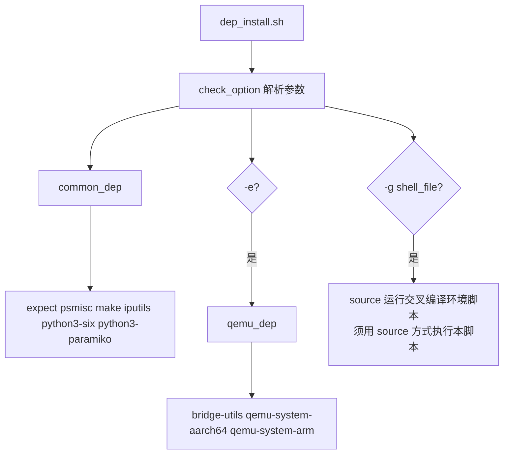

# 03 环境与配置

> 本章讲解 mugen 的环境配置体系：`conf/env.json` 结构、`write_conf.py` 如何探测并写入目标机信息、`read_conf.py` 如何注入环境变量、`modify_conf.py` 如何改用例配置、`dep_install.sh` 如何装框架依赖，以及多节点/物理机/云虚拟机（kvm）的配置差异。

## 1. 配置体系总览

```mermaid
flowchart LR
    subgraph 写配置
        A[mugen.sh -c --ip x --password y] --> B[write_conf.py]
    end
    B --> C[conf/env.json<br/>节点数组 NODE[]]
    C --> D[read_conf.py env-var]
    D --> E[export NODE&lt;id&gt;_&lt;ITEM&gt; 字符串]
    E --> F[conf/mugen.env 落盘]
    E --> G{远端模式 -s?}
    G --> H[SFTP → /mugen_re/conf/mugen.env]
    C --> I[mugen.sh -m 改用例配置 → modify_conf.py]
```

**配置文件的两种位置**：
- 系统安装模式：存在 `/etc/mugen/` 目录 → 配置文件在 `/etc/mugen/env.json`、`/etc/mugen/mugen.json`；
- 源码运行模式：无 `/etc/mugen` → 配置在仓库下 `conf/env.json`、`conf/mugen.json`。

## 2. `conf/env.json` 结构（write_conf.py 产物）

```json
{
  "NODE": [
    {
      "ID": 1,
      "LOCALTION": "local",          // 或 "remote"
      "MACHINE": "kvm",              // 或 "physical"
      "FRAME": "aarch64",            // uname -m 架构
      "USER": "root",
      "PASSWORD": "xxx",
      "SSH_PORT": 22,
      "NIC": "eth0",                 // 被测网卡
      "IPV4": "192.168.1.10",
      "IPV6": "...",
      "MAC": "...",
      "HOST_IP": "",                 // kvm 时为空
      "HOST_USER": "",
      "HOST_PASSWORD": "",
      "BMC_IP": "",                  // physical 时为空
      "BMC_USER": "",
      "BMC_PASSWORD": "",
      "COPY_ALL": "true"             // 可选，--run_remote --put_all 时写入
    },
    { "ID": 2, "LOCALTION": "remote", "MACHINE": "kvm", ... }
  ]
}
```

> `NODE_ITEM`（read_conf.py 第 29–46 行）定义了可导出字段，**注意字段名是 `LOCALTION`（历史拼写，write_conf.py 注释明确 TODO 应改为 LOCATION）**。

### MACHINE 类型与字段裁剪

| MACHINE | 含义 | 裁剪规则（read_conf.py read_configure） |
|---------|------|------------------------------------------|
| kvm | 云虚机/虚机 | **跳过 `BMC_*` 字段** |
| physical | 物理机 | **跳过 `HOST_*` 字段**（宿主信息） |

> `node_type()` 返回首个非 kvm 的节点类型，用于 `check_environment.py` 判断 `machine type == physical` 需求是否满足。

## 3. `write_conf.py`（mugen.sh -c，配置环境）逐函数

```mermaid
flowchart TD
    A[write_conf ip password port user run_remote copy_all] --> B{ip 缺失?}
    B -- 是 --> C[sys.exit 1]
    B -- 否 --> D{conf/env.json 已存在且含该 ip?}
    D -- 是 --> E[LOG_WARN 已录入, sys.exit 0]
    D -- 否 --> F[读旧 JSON, 新节点 ID = 最大 ID + 1]
    F --> G{ip 是本机? ip a 匹配}
    G -- 是 --> H[LOCALTION=local]
    G -- 否, run_remote -- 是 --> I[LOCALTION=local]
    G -- 否 --> J[LOCALTION=remote]
    J --> K[paramiko 连接目标机探测]
    K --> K1[hostnamectl 查 Virtualization:kvm → MACHINE]
    K --> K2[ip a 取 IPv6 / uname -m 取 FRAME]
    K --> K3[ip route 取 NIC → MAC]
    K --> L[run_remote? 插入为 NODE 0 并后移其它节点 ID<br/>否则 append]
    L --> M[写回 env.json]
```

**关键细节**：
1. **去重保护**：目标 ip 已存在于 env.json → 直接退出（避免重复录入）；还会 SSH 到目标机取它所有 IP，若与已录入机器是同一台也拒绝；
2. **认证方式**：有密码用密码；无密码尝试 `/root/.ssh/id_rsa` 私钥，无私钥提示"配置免密，请先创建互信"；
3. **机器类型判定**：`hostnamectl | grep 'Virtualization: kvm'` 有输出=kvm（虚机），否则 physical；`--run_remote` 时强制 physical（远端机视为物理机）；
4. **run_remote 语义**：`--run_remote` 把目标机作为 **NODE1（本地执行机）**，已配置的机器 ID 全部 +1 后移——典型用法是"本机不跑、全推给远端执行"；`--put_all` 则给 NODE1 加 `COPY_ALL=true`（让 mugen.sh 一次性把整套 testcases 拷贝到远端）。
5. **CLI 参数**：`--ip --password --port --user --run_remote --put_all`。

## 4. `read_conf.py`（读取环境变量）逐函数

| 函数 | 返回值 | 说明 |
|------|--------|------|
| `parse_json()` | dict | 定位并解析 env.json（`/etc/mugen/` 或 `$OET_PATH/conf/`） |
| `read_configure()` | 字符串 | 逐节点逐字段生成 `export NODE<id>_<ITEM>=<value>` 行，含 COPY_ALL；按 MACHINE 裁剪字段 |
| `node_num()` | int | 返回**最大节点 ID**（即节点数） |
| `node_type()` | str | 返回首个非 kvm 的 MACHINE（否则 kvm） |

CLI：`read_conf.py env-var | node-num | node-type`。

## 5. `modify_conf.py`（mugen.sh -m，改用例配置）

```
bash mugen.sh -m --suite <suite> --conf <conf> --key <key> --value <value>
```

- 实现：`find $OET_PATH/testcases -name <suite>` 定位套件目录 → `sed -i 's#<key>=.*#<key>="<value>"#g' <suite>/<conf>`；
- 用途：动态修改用例自带的配置文件（如某个用例 `config_params` 需要的参数），无需改脚本。

## 6. `dep_install.sh`（框架依赖安装）



| 参数 | 说明 |
|------|------|
| `-e` | 额外安装 QEMU 依赖（远程嵌入式测试用） |
| `-g shell_file` | 加载交叉编译环境脚本（**必须 `source` 方式运行 dep_install.sh**） |
| `-h` | 帮助 |

## 7. `configure_repo.sh`（软件源配置）

- 读取 `/etc/openEuler-latest` 获得 `openeulerversion`（或外部传入 `version_info`）；
- 生成 `/etc/yum.repos.d/<version>.repo`：`OS/everything/source/update/update_source` 5 个官方源 + EPOL 系列（20.03-LTS-SP1 为 `EPOL/` 路径，其它版本为 `EPOL/main/`）；
- 可追加内部更新测试源（`service_ip=121.36.84.172`，通过 update.json 探测最新目录名）；
- 用途：测试前确保被测环境有可用的 openEuler 软件源，`DNF_INSTALL` 才能成功。

## 8. 环境变量全集（用例侧可直接引用）

由 `load_conf` 注入，每个节点 `NODE<id>` 前缀：

| 变量 | 来源 | 示例 |
|------|------|------|
| `NODE<id>_LOCALTION` | write_conf | local / remote |
| `NODE<id>_MACHINE` | write_conf | kvm / physical |
| `NODE<id>_FRAME` | uname -m | aarch64 / x86_64 |
| `NODE<id>_USER` | -c --user | root |
| `NODE<id>_PASSWORD` | -c --password | xxx |
| `NODE<id>_SSH_PORT` | -c --port | 22 |
| `NODE<id>_NIC` | ip route 探测 | eth0 |
| `NODE<id>_IPV4` | -c --ip | 192.168.1.10 |
| `NODE<id>_IPV6` | ip a 探测 | fe80::... |
| `NODE<id>_MAC` | /sys/class/net 探测 | 52:54:... |
| `NODE<id>_HOST_IP/USER/PASSWORD` | kvm 空值 | — |
| `NODE<id>_BMC_IP/USER/PASSWORD` | physical 空值 | — |
| `NODE<id>_COPY_ALL` | --put_all | true |

> **多机用例示例**：`P_SSH_CMD --node 2 --cmd "echo $NODE2_IPV4"`、`SSH_CMD "cmd" $NODE2_IPV4 $NODE2_PASSWORD $NODE2_USER`。

## 9. 配置一份环境的完整流程（新手照做）

```bash
# 1. 安装框架依赖（一次）
bash dep_install.sh

# 2. 配置目标机（重点：ip/password 必填）
bash mugen.sh -c --ip 192.168.1.10 --password 'xxx' --user root --port 22

# 3. 验证配置生效
python3 libs/locallibs/read_conf.py env-var     # 应输出 export NODE1_* 系列

# 4. 可选：远端执行模式
bash mugen.sh -c --ip 192.168.1.10 --password 'xxx' --run_remote --put_all

# 5. 跑一个用例验证环境
bash mugen.sh -f 某个套件 -r 某个用例
```

## 10. 多节点配置实战

| 场景 | 操作 |
|------|------|
| 双机（NODE1 控制机 + NODE2 被测机） | 先 `-c` 配 NODE1，再 `-c` 配 NODE2（自动 ID=2） |
| 三机集群（如 corosync-qdevice 要求 physical 3 机） | 依次 `-c` 三台，JSON 中 MACHINE=physical |
| 云环境 kvm | `-c` 时自动识别 Virtualization:kvm，跳过 BMC 字段 |
| 需要额外磁盘的用例（如 cryptsetup 需 add disk） | 套件 JSON 声明 `add disk`，执行时 `check_environment.py` 校验 |
| 需要额外网卡的用例 | 套件 JSON 声明 `add network interface` |

> suite2cases 中声明的环境约束（machine num / machine type / add disk / add network interface）在**用例执行前**由 `CHECK_ENV`（check_environment.py）校验，不满足自动 skipped。典型约束示例见 09 章清单中标注。
