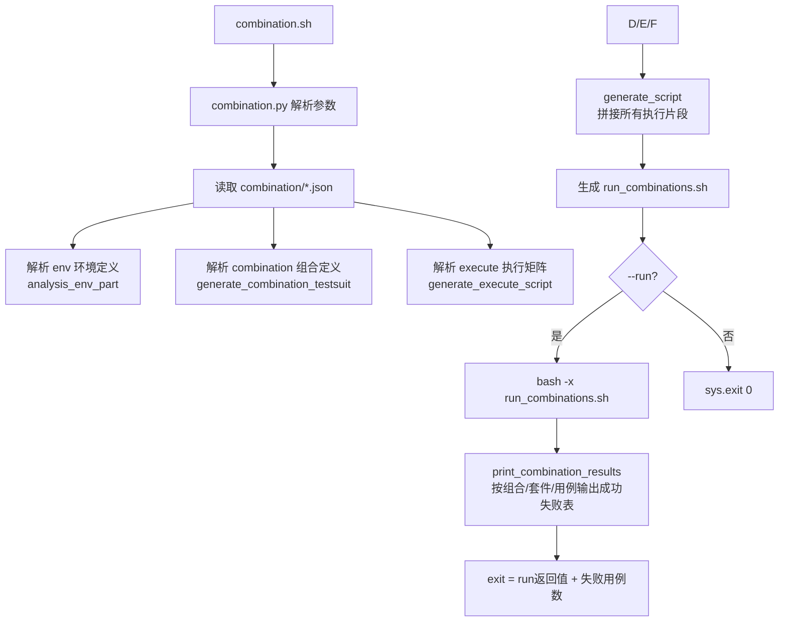
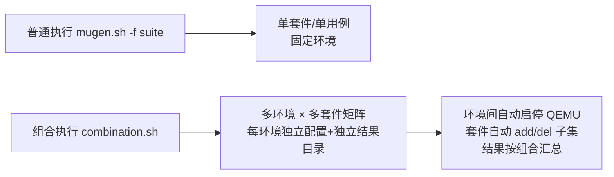

# 04 组合测试（combination）

> 组合测试解决"**在一套/多套环境中批量跑多个测试套、且各环境配不同的用例集合**"的诉求。典型场景：openEuler Embedded 在 aarch64/arm/x86 QEMU 与真实板卡（raspi4）上分别跑基础套件、第三方包、LTP、POSIX、tiny 镜像测试。本章基于 `combination.py`（524 行）与 `combination/*.json` 展开。

## 1. 入口与总体流程

```bash
# 入口脚本（仓库根）
bash combination.sh <组合JSON名>... [--run] [--all] [--print] [--file] [--dir]

# 实际执行的是
python3 libs/locallibs/combination.py "$@"
```



## 2. 组合 JSON 格式（字段语义）

| 字段 | 类型 | 说明 |
|------|------|------|
| `export` | dict | 执行前 export 的环境变量（执行后还原为原值），如 `DOWNLOAD_BRANCH=openEuler-24.03-LTS`、`FIND_TINY_DIR`、`OS_RELEASE_NAME` |
| `env` | 数组 | 环境定义，每项一个 `name`+`type`（`qemu`/`host`），见下 |
| `combination` | 数组 | 组合定义：`name` + `testcases[]`（每项 `testsuite` 名，可带 `add`/`del` 用例子集） |
| `execute` | 数组 | 执行矩阵：每项 `env:[...]`（引用 env 的 name）+ `combination`（引用组合 name），**一对执行=一套环境上跑一个组合** |

### env 定义字段

| type | 必填/常用字段 | 说明 |
|------|---------------|------|
| `qemu` | `kernal_img_path`、`initrd_path`、`qemu_type`（aarch64/arm/x86_64） | 内核/initrd 本地不存在时自动 `wget` 下载到 `tmp_download/<env>/`；`memory_size`(MB)、`cpu`、`machine`、`login_wait_str`（登录提示串）、`option_wait_time`、`sdk_path`、`put_all` |
| `host` | `ip`、`password` | 已部署好的真实主机/板卡；`port`、`user`、`run_remote`(true→用例跑在该主机)、`sdk_path`、`put_all` |

### combination 的 add/del 子集机制（generate_suite_dir）

- 无 `add`/`del`：原样复制 `suite2cases/<testsuite>.json` 到组合套件目录；
- `add`（字符串或数组）：仅保留原套件中在 add 列表里的用例 → 生成**子集套件**；
- `del`：剔除 del 列表中的用例 → 生成**差集套件**；
- 组合套件目录：`$OET_PATH/tmp_<n>_<json名>_<组合名>_suite/`（前缀 `tmp_<n>_<json名>_` 由 `generate_script` 传入，n=该组合在命令行中的序号）；
- 目录内套件 JSON 命名为 `<套件名>_<序号>.json`（序号从 0 递增，被跳过的项序号不连续）；
- 过滤后用例为空 → 不生成该 JSON。

> 例：`embedded_os_basic_extra_test` 套件在 qemu 组合中 `del: ["oe_test_acl_allow_change_nochange","oe_test_acl_ordinary_users_setgid","oe_test_curl_test_001"]`，在设备组合中只 `del: ["oe_test_iptables_cli_test"]` —— 同一套件在不同环境跑不同子集。

## 3. 执行脚本生成机制（generate_execute_script）

每个 execute 条目生成一段 bash，段间用 `echo "---run execute_N"` 分隔：

```
bash qemu_ctl.sh stop                    # 先停残留 QEMU
rm -rf conf                              # 清空环境配置
<env_script>                             # 启动 QEMU / 配置 host（见下）
mv suite2cases tmp_suite2cases           # 换掉正式套件目录
mv <组合套件目录> suite2cases
bash mugen.sh -a -b                      # 预编译（有 Makefile 的套件 make）
bash mugen.sh -a [-s]                    # 全量执行（qemu→-s 远端；host→-x 本地或按 run_remote）
mkdir -p combination_results/<组合>_<n>
cp -r results/* combination_results/<组合>_<n>
bash libs/locallibs/combination_do_clean.sh   # 全部套件 make clean
mv suite2cases <组合套件目录>              # 恢复目录
mv tmp_suite2cases suite2cases
[bash qemu_ctl.sh stop; rm -rf tmp_download]   # qemu 场景收尾
```

### env_script 生成（generate_execute_env_script）

| env.type | 生成动作 |
|----------|----------|
| `host` | `bash mugen.sh -c --ip x --password y --port 22 --user root [--run_remote] [--put_all]`（配置环境） |
| `qemu` | ①如缺镜像 `mkdir+wget` 下载 zImage/initrd ②`bash qemu_ctl.sh start --kernal_img_path ... --initrd_path ...`（透传 env 其余键，布尔键只加 `--key`）③qemu 环境一律按远端执行（`run_remote` 置 True，最终 `mugen.sh -a -s`） |
| 任一含 `sdk_path` | `generate_sdk_set_script`：若 sdk 是 URL→`wget`+`sh sdk.sh`（交互填安装路径和 y）；若是本地安装脚本→`sh sdk_path`；最后 `export SDK_PATH=<安装目录>` |

> **env 键的布尔值**（如 `put_all:true`、`run_remote:true`）生成参数时只加 `--key`（无值），普通值生成 `--key "value"`。

## 4. 结果输出（print_combination_results）

- 汇总 `combination_results/<组合>_<执行序号>/<套件>/succeed|failed/<用例>`；
- 打印**ASCII 表格**（列：combination_name / testsuite_name / testcase_name / result），表头与列宽按最长名字动态对齐；
- 统计失败用例数，`sys.exit(run_proc.returncode + 失败数)`——**有失败则整体非零退出**。

## 5. 仓库内 6 个组合 JSON（embedded 版本回归矩阵）

| 文件 | 环境数 | 组合数 | 执行矩阵要点 |
|------|-------:|-------:|--------------|
| embedded_ci_test.json | 2（qemu_1 + host_1） | 2 | normal_test（qemu 上跑 os_basic+security+application）、tiny_test（host 上跑 tiny 镜像） |
| embedded_version_test_round_1.json | 6（4 qemu + raspi4 + tiny host） | 7 | 每轮矩阵：qemu_aarch64/arm/x86 跑 basic；big_mem 跑 third_party；aarch64 跑 posix；raspi4 跑 basic/third_party/posix/ltp；tiny host 跑 tiny |
| embedded_version_test_round_2.json | 同构 | 同构 | 版本回归第 2 轮 |
| embedded_version_test_round_3.json | 同构 | 同构 | 版本回归第 3 轮 |
| embedded_version_test_round_4.json | 同构 | 同构 | 版本回归第 4 轮 |
| embedded_version_test_round_5.json | 同构 | 同构 | 版本回归第 5 轮 |

> 版本回归轮次的存在说明：嵌入式测试在**版本迭代周期内对同一批镜像做多轮回归**（round 1–5 共用同一组合矩阵定义，仅因时间分轮执行，便于对比轮间结果）。

## 6. 组合测试 CLI 参数

| 参数 | 说明 |
|------|------|
| `组合名...`（位置参数） | 指定 `combination/` 下要跑的组合 JSON（可不带 .json 后缀） |
| `--run / -r` | 生成脚本后**立即执行**（bash -x） |
| `--all / -a` | 跑 `combination/` 下全部 JSON |
| `--file / -f 路径` | 指定任意路径的组合 JSON |
| `--dir / -d 目录` | 指定目录下的全部组合 JSON |
| `--print / -p` | 仅打印已有组合测试结果（不执行） |

## 7. 组合测试与普通执行的差异（一图对比）



**何时用组合测试**：
1. 一套用例要在多种架构/多种设备上验证（嵌入式版本回归）；
2. 同一套件在不同环境需要不同的用例集合（add/del）；
3. 需要自动化串行跑多轮（round 1–5）。
