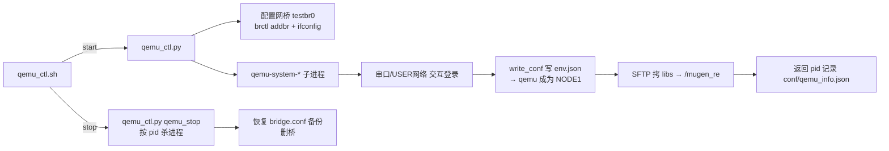
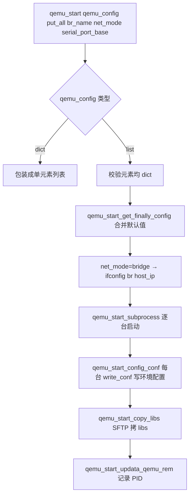
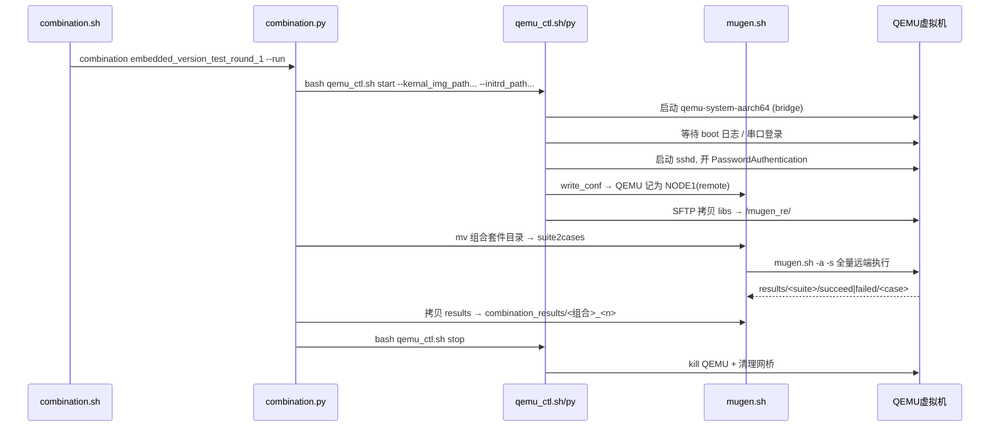

# 05 QEMU 嵌入式测试

> 本章解析 openEuler Embedded 场景的 QEMU 设备控制：`qemu_ctl.sh`（桥接配置+入口）与 `qemu_ctl.py`（QEMU 进程管理）逐函数分析，并介绍 `testcases/embedded-test/` 的嵌入式用例域。

## 1. 为什么需要 QEMU 控制

openEuler Embedded 没有物理硬件时，用 QEMU 模拟 aarch64/arm/x86 运行嵌入式镜像（zImage + initrd）。QEMU 作为被测"远端 NODE"，框架需要：
1. 启动 QEMU 并等待其 boot 完成、sshd 可用；
2. 把环境配置（env.json）与 libs 传到 QEMU 内 `/mugen_re/`；
3. 让 mugen.sh 通过 SSH（`-s` 远端模式）在其上执行用例；
4. 结束后杀掉 QEMU、清理网桥。



## 2. `qemu_ctl.sh`（bash 入口，137 行）

职责分三段：

### 2.1 参数解析与网桥配置（第 19–92 行）
- `OET_PATH` 固定为脚本所在目录；
- 手工遍历 `$@` 识别 `start|stop` 操作、`--br_name <名>`（默认 `testbr0`）、`--net_mode <bridge|user>`；
- `start` 且 `net_mode=bridge`：备份 `/etc/qemu/bridge.conf` 与 `/usr/local/etc/qemu/bridge.conf` → 追加 `allow <br>` → `brctl addbr <br>` + `ifconfig <br> up`；支持 `MUGEN_QEMU_ACL_DIR` 环境变量指定额外 ACL 目录；
- `start` 且 `net_mode=user`：**跳过网桥配置**（无需 root，用 localhost 端口转发）。

### 2.2 转发给 qemu_ctl.py（第 94–116 行）
- 支持 `-d/--daemon`：`nohup python3 qemu_ctl.py "$@"` 后台运行，日志 `logs/qemu_ctl.log`；
- 默认前台运行。

### 2.3 stop 时网桥清理（第 118–137 行）
- 从 `.bak` 恢复两个 bridge.conf（或删除），删除 `MUGEN_QEMU_ACL_DIR/bridge.conf` 备份；`net_mode=user` 跳过。

## 3. `qemu_ctl.py`（700 行）逐函数

### 3.1 全局配置
- `save_path = conf/qemu_info.json`：记录所有已启动 QEMU 的 PID；
- `MAX_QEMU_NUM = 253`；
- 全局默认：`option_wait_time=60`、`login_wait_time=2`、`extra_set_passwd=False`；
- 默认参数：qemu_type=aarch64、machine=virt-4.0、cpu（aarch64:cortex-a57 / arm:cortex-a15）、qemu_ip=192.168.10.x、user=root、passwd=openEuler@123、memory=2048M。

### 3.2 生命周期控制函数

| 函数 | 职责 |
|------|------|
| `qemu_support()` | 打印支持的 JSON key 帮助 |
| `qemu_load_qemu_info()` | 读 `conf/qemu_info.json` 的 `start_pids` 列表 |
| `qemu_stop()` | 遍历 `start_pids` 逐个 `os.kill(SIGKILL)`，删除 save_path |
| `qemu_start_updata_qemu_rem(all_sub)` | 把新启动的子进程 PID 追加写回 qemu_info.json |
| `qemu_start_stop_all(sub_list)` | terminate+kill 一组 QEMU 子进程（启动失败兜底） |
| `qemu_start_wait_start(sub_list, wait_time=60)` | 等待启动成功的全局标志 `is_qemu_ok`，超时则停止所有子进程 |
| `qemu_start_wait_output(...)` | 启动线程等待 boot 日志中出现指定字符串 |
| `socket_wait_output(sock, wait_str, wait_time)` | USER 网络模式：串口 socket 收数据、去 ANSI 转义、等期望串 |
| `socket_send_cmd(sock, cmd, wait)` | 串口发命令并等待 |

### 3.3 启动主流程



#### `qemu_start_get_finally_config`（配置合并）
- 逐台 QEMU：缺省补默认值，IP 从 `192.168.10.<n>` 自动递增（`qemu_start_get_begin_ip_num` 依据已启动数量续号），MAC `52:54:00:12:34:<xx>`；
- 校验必填 key：`kernal_img_path`、`initrd_path`；
- 若设置 `qemu_ip` 则必须同时设置 `host_ip`；未设 qemu_ip 时 host_ip 默认 `192.168.10.1`；
- 输出 `finally_config`：各属性按 `_list` 收集（支持一配置文件多台 QEMU）。

#### `qemu_start_make_cmd`（构造 qemu 命令行）
```
qemu-system-<type> -M <machine> -cpu <cpu> -m <mem> -kernel <zImage> -initrd <initrd>
  [-display none -serial tcp::<port>,server,nowait -monitor none]   # user 模式
  [-nographic]                                                       # bridge 模式
  -device virtio-net-<pci|device>,netdev=tap0,mac=<mac>
  -netdev user,id=tap0,hostfwd=tcp::<host_port>-:<qemu_port>   # user 模式端口转发
  -netdev bridge,id=tap0,br=<br>                               # bridge 模式
```

#### 网络模式差异

| 模式 | 串口 | 网络 | 登录方式 | SSH 地址 |
|------|------|------|----------|----------|
| `bridge`（默认，需 root） | `-nographic` | 网桥 tap0 | 日志中等待 `login_wait_str` | `qemu_ip:qemu_ssh_port`（192.168.10.x:22） |
| `user`（无需 root） | `-serial tcp::1111,server` | `hostfwd` 端口转发 | 先连 127.0.0.1:1111 串口发用户名/密码 | `127.0.0.1:host_ssh_port`（默认 2222） |

#### `qemu_start_subprocess_user`（USER 模式串口登录，嵌入式镜像无默认密码时用）
1. 启动 QEMU，5s 后检查未退出；
2. 连串口 `127.0.0.1:1111+<i>`，发回车等 `check_login_str`（默认 `login:`）；
3. 依次发 `user`、`passwd`×2、回车，完成登录；`extra_set_passwd` 时再执行 `passwd <user>` 设置密码；
4. 发 `echo 'login qemu'` 确认已登录；
5. 可选：执行 `start_sshd_cmd` 启动 sshd（如 `check_sshd_start_cmd || start_sshd_cmd`），并循环 `check_sshd_start_cmd` 直到回显 `check run sshd ok`；
6. 修改 sshd_config 开启 `PasswordAuthentication yes`，`kill -HUP` 重载，sleep 10s 等 sshd 就绪；
7. 关闭串口与日志句柄。

#### `qemu_start_config_conf`（把 QEMU 写成 NODE1）
- 对每台 QEMU 调 `write_conf.py --ip <ssh_ip> --password ... --port ... --user ... [--run_remote] [--put_all]`；
- **只有第 1 台（i==0）带 `--run_remote`**（QEMU 即 NODE1，用例跑在 QEMU 上）；`put_all` 时全部带 `--put_all`；
- 启动前 `qemu_start_wait_ssh_connect` 轮询等待 SSH 可连（最多 option_wait_time）。

#### `qemu_start_copy_libs`
- 逐台 `sftp.py put --node -1 --ip <ssh_ip> --localdir $OET_PATH/libs/ --remotedir /mugen_re/`。

### 3.4 入口 `qemu_control(option, args)`
- `stop`：`qemu_stop()`（拒绝带 config_file）；
- `start`：优先 `--config_file <json>` 读多台 QEMU 配置；否则用命令行各 `--qemu_type/--user/--passwd/...` 组装单台配置；
- 透传全局参数：`login_wait_str`（默认 `login:`）、`login_wait_time`、`option_wait_time`、`start_sshd_cmd`、`check_sshd_start_cmd`、`net_mode`、`serial_port_base`、`verbose`；
- 校验：指定 config_file 时不能再叠加其它配置参数（否则报错退出）。

## 4. 命令行示例

```bash
# 启动 1 台 aarch64 QEMU（bridge 模式，默认配置）
bash qemu_ctl.sh start --kernal_img_path /tmp/zImage --initrd_path /tmp/initrd

# 从 JSON 配置启动（多台）+ 后台
bash qemu_ctl.sh start --config_file conf/qemu.json --daemon

# 停止
bash qemu_ctl.sh stop

# USER 网络模式（无需 root），登录后启动 sshd
bash qemu_ctl.sh start --net_mode user --host_ssh_port 2222 \
  --kernal_img_path /tmp/zImage --initrd_path /tmp/initrd \
  --start_sshd_cmd "/usr/sbin/sshd" --check_sshd_start_cmd "pgrep sshd"
```

> 注意：CLI 参数名沿用了源码中的 `kernal_img_path`（kernel 的拼写错误，源码原文如此），JSON 中也是 `kernal_img_path`。

## 5. 嵌入式用例域（testcases/embedded-test/）

| 测试套 | 目录 | 用例数 | 内容 |
|--------|------|-------:|------|
| embedded_os_basic_test | os_basic_tests/ | ~49 | 嵌入式基础命令（ls/cat/cd/chmod/cp/date/df/groupadd 等逐命令用例，每用例独立目录） |
| embedded_os_basic_extra_test | os_basic_extra_tests/ | — | 基础命令补充（acl/curl/iptables 等） |
| embedded_security_config_test | security_config_test/ | — | 安全加固配置 |
| embedded_application_develop_tests | application_develop_tests/ | — | 应用开发（C++ hello world 等，SDK 交叉编译） |
| embedded_third_party_packages_test | third_party_packages_test/ | — | 第三方包（tcl/boost 等，用 manifest 清单管理，产物 gitignore） |
| embedded_version_basic_tests | version_basic_tests/ | — | 版本级 LTP/POSIX 套件（`oe_test_version_ltp_test_001`/`oe_test_version_posix_suite_test_001`） |
| embedded_tiny_image_test | tiny_image_test/ | — | tiny 镜像测试 |
| embedded_version_*_tests | — | — | 版本回归专用 |

**嵌入式用例特点**：
1. 每个用例一个**同名目录**（`oe_test_basic_cmd_ls/oe_test_basic_cmd_ls.sh`），便于按目录原子管理；
2. 通过组合测试 JSON 在多种 QEMU 架构/设备上执行；
3. 交叉编译类用例（application/third_party）依赖 `SDK_PATH`（qemu_ctl/combination 生成的 `export SDK_PATH`）；
4. 部分套件（third_party_packages_test / version_basic_tests）在测试运行时生成 `comm_lib.sh`、`manifest_map.json`、`manifest_parse.sh`（已在 .gitignore 中忽略）。

## 6. 嵌入式测试执行链路（一次组合执行）


