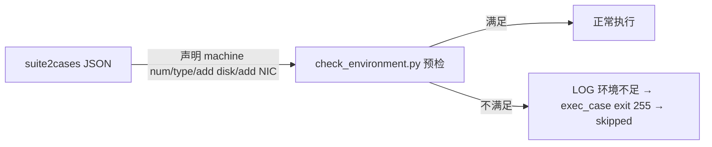

# 07 多维度测试分析

> 本章从**测试类型**、**测试大类**、**测试因子（环境约束）** 三个维度对全库 979 套件 / 7189 用例做量化分析。维度一、二基于套件名/用例描述的关键字统计（标注方法），维度三基于 suite2cases 约束字段的**精确计数**（100% 事实）。

## 维度一：测试类型分布

**方法说明**：对 7189 个用例的 `@Desc` 与所属套件名做关键字匹配（如 desc 含 `perf/benchmark/stress` 判为性能），结果如下（仅作量级参考，非精确标签）：

| 测试类型 | 用例数 | 占比 | 典型体现 |
|---------|-------:|-----:|----------|
| 功能/命令测试 | 6884 | 95.8% | 绝大多数字符串：命令选项、配置文件、服务启停、API 行为 |
| 安全测试 | 121 | 1.7% | 权限(ACL/PAM/SELinux)、加密(TLS/OpenSSL/加密套件)、审计(audit)、密钥管理 |
| 配置管理 | 71 | 1.0% | config 子命令、配置文件合法性、服务 reload |
| 可靠性/异常恢复 | 67 | 0.9% | 异常输入、进程崩溃、重启恢复、错误路径（FS_Negative 全套即此类型） |
| 兼容性/多版本 | 29 | 0.4% | 版本变体套件、多架构断言、新旧命令对照 |
| 性能/压测 | 17 | 0.2% | LTP/UNIXBENCH/sysbench、fio/iozone、webbench/iperf/qperf |

> **解读**：mugen 以**功能验证**为绝对主体（这是版本测试框架的定位），性能/压测有独立套件（`embedded_unixbench_test`、`fio`、`webbench` 等）但占比小；安全与可靠性测试通过 security_test 专题域和 FS_Negative 等专项套件覆盖。

## 维度二：测试大类（主题域）分布

**方法说明**：基于套件名做"词边界"关键词匹配归入策划主题域（精确匹配、无子串误判），未匹配的 772 个套件为"以软件包命名的特性套件"（即一个软件包=一个特性=一个套件）。

| 主题域 | 套件数 | 代表套件 | 对应 cli-test 数量 |
|-------|-------:|----------|-------------------|
| 编译器与开发工具 | 29 | gcc/binutils/glibc/cmake/valgrind/python | 多为 cli-test |
| 安全与认证 | 22 | audit/openssl/cryptsetup/clevis/crypto-policies | 多为 cli-test |
| 文件系统与存储 | 16 | FS_Device/FS_File/FS_FileSystem/FS_IO/FS_Negative | system-test |
| 命令行与 Shell 工具 | 15 | coreutils/bash/curl/diffutils/util-linux | cli-test |
| 嵌入式 | 15 | embedded_os_basic_test/embedded_mcs_rpi4_test | embedded-test |
| 网络工具 | 13 | NetworkManager/bridge-utils/arptables/bluez | cli-test |
| 桌面与图形 | 11 | ImageMagick/GraphicsMagick/fontconfig/OpenEXR | cli-test |
| 监控与运维 | 11 | grafana/cockpit/htop/alertmanager/aops | cli-test |
| DNS 与网络服务 | 11 | bind/chrony/dnsmasq/libiscsi/samba | cli-test |
| 数据库 | 11 | mariadb/mysql/etcd/leveldb/redis/389-ds-base | cli-test |
| 虚拟化与容器 | 8 | containerd/cri-o/criu/libvirt/lxc | cli-test |
| 分布式与集群 | 8 | corosync/dlm/hadoop/kubernetes/pacemaker | cli-test/system-test |
| Web 服务器与应用 | 8 | httpd/haproxy/jetty/lighttpd | cli-test |
| 系统服务与初始化 | 6 | dbus/polkit/irqbalance/syscare | cli-test |
| 系统管理工具 | 5 | anaconda/dmidecode/hwloc/pam | cli-test |
| 包管理与仓库 | 4 | dnf/createrepo_c/libreport/PackageKit | cli-test |
| 文本处理 | 4 | asciidoc/jq/poppler/qpdf | cli-test |
| 内核与驱动 | 3 | kernel/etmem/elasticMem | system-test |
| 多媒体 | 3 | ffmpeg/flac/wavpack | cli-test |
| 驱动专项 | 1 | leptonica（+driver_test 素材域） | driver_test |
| 办公与文档 | 1 | texlive | doc-test |
| **其他/第三方软件包** | 772 | 389-ds-base/A-Tune/Kmesh/ModemManager... | 逐包一特性 |

> **解读**：仓库的"测试大类"本质上是**按被测软件包聚类**。772 个"其他"正是绝大多数以第三方软件包命名的特性套件，每个套件的用例即为该包的测试点全集——这种组织方式让"按包找用例、按包补用例"非常直接。完整逐包清单见 09 章附录；代表性套件深挖见 08 章。

## 维度三：测试因子库（环境约束）

**数据来源**：979 个 suite2cases JSON 中 `machine num`、`machine type`、`add disk`、`add network interface` 四个约束字段的**精确出现次数**（100% 事实）。

### 3.1 因子项与计数

| 因子 | 含义 | 套件级声明 | 用例级声明 | 用例级占比 |
|------|------|----------:|----------:|-----------:|
| `machine num` | 需要的机器数（≥2 即多机） | 80 套件 | 1610 用例 | 22.4% |
| `machine type` | 机器类型要求（physical/kvm） | 33 套件 | 387 用例 | 5.4% |
| `add disk` | 需要额外（未挂载）磁盘 | 29 套件 | 1007 用例 | 14.0% |
| `add network interface` | 需要额外网卡 | 18 套件 | 764 用例 | 10.6% |

> 套件级声明 = 套件 JSON 顶层字段（作用于套件内所有用例）；用例级声明 = 用例条目内字段（仅该用例生效）。执行前 `check_environment.py` 逐项校验，不满足 → 用例 **skipped(255)** 而非 failed。

### 3.2 因子使用解读

1. **多机测试（22.4% 用例）**：集群/主备/分布式验证的主力，典型如 `corosync-qdevice`（3 机）、`corosync`、`dlm`、`distributed_file_test`、`embedded_mcs_*`。用例内通过 `P_SSH_CMD --node N` 与 `$NODE<id>_*` 变量操作第二/第三台机器；
2. **额外磁盘（14.0%）**：破坏性存储测试需要空闲盘，如 `FS_Device`、`fio`、`cryptsetup`（加密建盘）、`clevis`；`get_test_device.py` 的 `TEST_DISK` 专门返回"未挂载空闲磁盘"列表供这些用例使用；
3. **额外网卡（10.6%）**：网络隔离/桥接/多 NIC 场景，如 `bridge-utils`、`firewalld`、`gazelle`；`TEST_NIC` 返回"未配置可用网卡"；
4. **machine type=physical（5.4%）**：部分用例仅能在物理机执行（涉及真实硬件/BMC），声明后 kvm 环境自动跳过。

### 3.3 约束与执行链路

## 四、测试手法因子（工具使用，反映"怎么测"）

基于 `case_extract.json` 对 **7189 个注册用例**的静态抽取（41 个缺失脚本的用例无字段；计数为**用例级频次**，100% 事实）：

| 手法 | 用例数 | 用途 |
|------|-------:|------|
| CHECK_RESULT 断言 | 6461 | 断言验收：命令退出码/文件内容/服务状态 |
| DNF_INSTALL 前置装包 | 4958 | 先装被测包再测（无依赖则跳过） |
| pre_test/post_test | 6586/6737 | 环境准备与清理（回滚安装、删文件、重启服务） |
| SSH 远端操作 | 292 | 多机/嵌入式/主备测试 |
| config_params 参数化 | 226 | 同一脚本多配置复用 |
| EXECUTE_T 超时覆盖 | 123 | 长任务（压测/编译/大文件拷贝） |

## 五、三维度交叉结论

1. **广度**：覆盖 openEuler 全软件生态的功能测试（772 个第三方包特性 + 系统级特性）；
2. **深度**：每特性按"命令选项→配置文件→服务行为→异常路径"逐点验证，平均每套件 7.3 个用例；
3. **环境维度**：通过四类约束因子把测试扩展到多机、物理机、破坏性存储、多网卡等真实场景，且"环境不足即跳过"保障结果可信；
4. **手法维度**："装包→准备→执行→断言→清理"的黄金模板贯穿全库，新用例照此编写即与全库一致。
