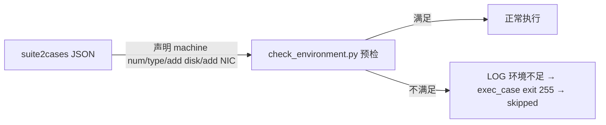

# 07 多维度测试分析

> 本章从**测试类型**、**测试大类**、**测试因子（环境约束）** 三个维度对全库 {{SUITES_TOTAL}} 套件 / {{CASES_TOTAL}} 用例做量化分析。维度一、二基于套件名/用例描述的关键字统计（标注方法），维度三基于 suite2cases 约束字段的**精确计数**（100% 事实）。

## 维度一：测试类型分布

**方法说明**：对 {{CASES_TOTAL}} 个用例的 `@Desc` 与所属套件名做关键字匹配（如 desc 含 `perf/benchmark/stress` 判为性能），结果如下（仅作量级参考，非精确标签）：

| 测试类型 | 用例数 | 占比 | 典型体现 |
|---------|-------:|-----:|----------|
{{TYPE_TABLE}}

> **解读**：mugen 以**功能验证**为绝对主体（这是版本测试框架的定位），性能/压测有独立套件（`embedded_unixbench_test`、`fio`、`webbench` 等）但占比小；安全与可靠性测试通过 security_test 专题域和 FS_Negative 等专项套件覆盖。

## 维度二：测试大类（主题域）分布

**方法说明**：基于套件名做"词边界"关键词匹配归入策划主题域（精确匹配、无子串误判），未匹配的 {{SUBJ_OTHER}} 个套件为"以软件包命名的特性套件"（即一个软件包=一个特性=一个套件）。

| 主题域 | 套件数 | 代表套件 | 对应 cli-test 数量 |
|-------|-------:|----------|-------------------|
{{SUBJECT_TABLE}}

> **解读**：仓库的"测试大类"本质上是**按被测软件包聚类**。{{SUBJ_OTHER}} 个"其他"正是绝大多数以第三方软件包命名的特性套件，每个套件的用例即为该包的测试点全集——这种组织方式让"按包找用例、按包补用例"非常直接。完整逐包清单见 09 章附录；代表性套件深挖见 08 章。

## 维度三：测试因子库（环境约束）

**数据来源**：{{SUITES_TOTAL}} 个 suite2cases JSON 中 `machine num`、`machine type`、`add disk`、`add network interface` 四个约束字段的**精确出现次数**（100% 事实）。

### 3.1 因子项与计数

| 因子 | 含义 | 套件级声明 | 用例级声明 | 用例级占比 |
|------|------|----------:|----------:|-----------:|
{{CONSTRAINT_TABLE}}

> 套件级声明 = 套件 JSON 顶层字段（作用于套件内所有用例）；用例级声明 = 用例条目内字段（仅该用例生效）。执行前 `check_environment.py` 逐项校验，不满足 → 用例 **skipped(255)** 而非 failed。

### 3.2 因子使用解读

1. **多机测试（{{PCT_CASE_MN}}% 用例）**：集群/主备/分布式验证的主力，典型如 `corosync-qdevice`（3 机）、`corosync`、`dlm`、`distributed_file_test`、`embedded_mcs_*`。用例内通过 `P_SSH_CMD --node N` 与 `$NODE<id>_*` 变量操作第二/第三台机器；
2. **额外磁盘（{{PCT_CASE_AD}}%）**：破坏性存储测试需要空闲盘，如 `FS_Device`、`fio`、`cryptsetup`（加密建盘）、`clevis`；`get_test_device.py` 的 `TEST_DISK` 专门返回"未挂载空闲磁盘"列表供这些用例使用；
3. **额外网卡（{{PCT_CASE_NIC}}%）**：网络隔离/桥接/多 NIC 场景，如 `bridge-utils`、`firewalld`、`gazelle`；`TEST_NIC` 返回"未配置可用网卡"；
4. **machine type=physical（{{PCT_CASE_MT}}%）**：部分用例仅能在物理机执行（涉及真实硬件/BMC），声明后 kvm 环境自动跳过。

### 3.3 约束与执行链路

## 四、测试手法因子（工具使用，反映"怎么测"）

基于 `case_extract.json` 对 **{{CASES_TOTAL}} 个注册用例**的静态抽取（{{MISSING_CASES}} 个缺失脚本的用例无字段；计数为**用例级频次**，100% 事实）：

| 手法 | 用例数 | 用途 |
|------|-------:|------|
{{TOOL_TABLE_07}}

## 五、三维度交叉结论

1. **广度**：覆盖 openEuler 全软件生态的功能测试（{{SUBJ_OTHER}} 个第三方包特性 + 系统级特性）；
2. **深度**：每特性按"命令选项→配置文件→服务行为→异常路径"逐点验证，平均每套件 {{AVG_CASES_PER_SUITE}} 个用例；
3. **环境维度**：通过四类约束因子把测试扩展到多机、物理机、破坏性存储、多网卡等真实场景，且"环境不足即跳过"保障结果可信；
4. **手法维度**："装包→准备→执行→断言→清理"的黄金模板贯穿全库，新用例照此编写即与全库一致。
