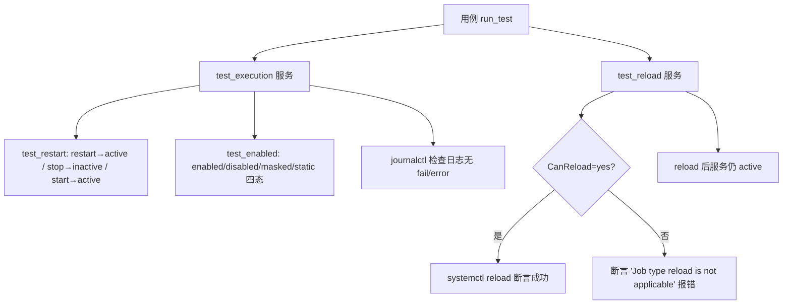

# 08 测试特性树

> 本章把全库 {{SUITES_TOTAL}} 套件 / {{CASES_TOTAL}} 用例组织成"**测试域 → 主题域 → 特性（套件）→ 测试点（用例）**"四层特性树，并对代表性特性做函数级深挖。主题域分组基于套件名的词边界关键词匹配（`subject_classify.py` 结果），未匹配的 {{SUBJ_OTHER}} 个套件为"以软件包命名的特性套件"（一个软件包 = 一个特性）。

## 1. 特性树总览

```mermaid
flowchart TD
    L1[L1 测试域 ×9] --> L2[L2 主题域 ×~22]
    L2 --> L3[L3 特性 = 套件 ×{{SUITES_TOTAL}}]
    L3 --> L4[L4 测试点 = 用例 ×{{CASES_TOTAL}}]
    L4 --> T[含 CHECK_RESULT 断言的用例 ×{{CHECK_CASES}}]
```

| 层级 | 含义 | 数量 | 说明 |
|------|------|-----:|------|
| L1 测试域 | 仓库目录结构 | 9 | cli-test / smoke / feature / system / embedded / doc / security / testsuite / driver |
| L2 主题域 | 被测对象类型 | ~22 | 数据库 / 网络 / 安全 / 存储 / 开发工具... |
| L3 特性 | 被测软件/组件 | {{SUITES_TOTAL}} | 一个套件 = 一个特性 |
| L4 测试点 | 特性下的行为验证 | {{CASES_TOTAL}} | 一个用例 = 一个测试点（含多条断言） |

## 2. 四层特性树（L1 → L2 → L3 → L4）

### 2.1 测试域（L1）→ 主题域（L2）

> 下表数字为**按测试域分别统计**的主题域套件数（词边界关键词匹配，方法同 `subject_classify.py`，未命中关键词的归入"其他/第三方软件包"）。

| L1 测试域 | L2 主题域（套件数） |
|-----------|---------------------|
{{L2_TABLE}}

> 注：**§2.2 及 §4 中的 L2 主题域计数为全库口径**（如"安全与认证 22 套件"是 {{SUITES_TOTAL}} 套件全库分类结果），与上表按域口径不同，引用时以章节内说明为准。

### 2.2 主题域（L2）→ 特性（L3）代表

| 主题域 | 代表特性（套件名） | 用例数 |
|--------|-------------------|-------:|
| 数据库 | 389-ds-base(62)、mariadb、mysql、etcd、leveldb、redis | 62~数百 |
| 网络工具 | NetworkManager、bridge-utils、arptables、bluez、gazelle | 3~50 |
| 安全与认证 | audit、openssl、cryptsetup、clevis、crypto-policies、container-selinux | 5~30 |
| 文件系统与存储 | FS_File、FS_FileSystem、FS_Device、FS_Negative、fio、cryptsetup | 数十 |
| 虚拟化与容器 | containerd、cri-o、criu(+3.15/3.16)、libvirt、lxc | 10~50 |
| Web 服务 | httpd、haproxy、jetty、lighttpd | 5~20 |
| 命令行工具 | coreutils、bash、curl、diffutils、gdisk/sgdisk | 2~20 |
| 分布式集群 | corosync(+qdevice)、dlm、keepalived、pacemaker | 5~10 |
| 开发工具 | gcc、binutils、glibc、cmake、valgrind、python 系 | 3~30 |
| 嵌入式 | embedded_os_basic_test(49)、embedded_mcs_rpi4_test | 5~49 |

> 完整逐套件清单见 **09 附录-全量测试套清单**（979 套件全枚举）；此处仅列代表。

## 3. 代表性特性深挖（函数级）

### 3.1 服务测试模式（cli-test/common/common_lib.sh）——覆盖数百个服务套件

**入口**：`testcases/cli-test/common/common_lib.sh`（被 abrt/389-ds/httpd 等服务套件 source）。



| 函数 | 职责 | 关键断言 |
|------|------|----------|
| `test_execution service` | 服务全生命周期冒烟 | restart→active、enabled、日志无 error（`journalctl --since | grep -i fail|error` 反向断言） |
| `test_restart service` | 重启/停止/启动三轮 | 每步 `systemctl status | grep "Active: active/inactive"` + CHECK_RESULT |
| `test_enabled service` | 开机自启使能/禁用 | 按 `systemctl is-enabled` 四态分支，验证 symlink 文件存在性（enable→Created symlink，disable→Removed） |
| `test_oneshot service status` | oneshot 型服务 | 状态校验 + enabled + 日志检查 |
| `test_reload service` | 重载配置 | `CanReload` 探测→reload 或断言"not applicable"，并验证状态不漂移 |

**用例范式**（以 `oe_test_service_abrtd.sh` 为例，41 行）：
```bash
source "${OET_PATH}/testcases/cli-test/common/common_lib.sh"
pre_test  → DNF_INSTALL "abrt"                # 装被测包
run_test  → test_execution abrtd.service      # 全生命周期
            test_reload abrtd.service          # 重载
post_test → DNF_REMOVE "$@"                    # 卸载回滚
main "$@"
```

> 结论：**服务类特性的测试点 = 装包 → 启停循环 → 自启状态 → 重载 → 日志无错 → 卸载**。全库服务套件（如 389-ds 的 `oe_test_service_dirsrv-snmp`、abrt 的 7 个 service 用例）共用此模板，测试点高度统一。

### 3.2 磁盘分区特性（cli-test/gdisk，13 用例）

**被测对象**：GPT 分区工具 `gdisk` 与 `sgdisk`（非交互版）。

| 测试点（用例） | 验证内容 | 关键断言 |
|----------------|----------|----------|
| `oe_test_gdisk_create_partition` | 创建 GPT 分区 | 10 条断言：分区表读取、分区编号、类型 |
| `oe_test_gdisk_create_partition_128` | 创建第 128 个分区（上限） | `CHECK_RESULT "$num" 129`（分区数==129 含表头） |
| `oe_test_gdisk_sort_partition` | 分区排序 | `CHECK_RESULT "$num" 3` / `"$No" 1` |
| `oe_test_gdisk_change_partition_name` | 修改分区名 | 正向+反向断言 |
| `oe_test_gdisk_change_partition_type_code` | 修改分区类型码 | 3 条 |
| `oe_test_gdisk_check_partition_info` | 分区信息校验 | 3 条 |
| `oe_test_gdisk_verify_disk` | verify 磁盘一致性 | — |
| `oe_test_sgdisk_backup_and_restore` | sgdisk 备份/恢复分区表 | 10 条（含备份文件比对） |
| `oe_test_sgdisk_change_disk_guid` | 修改磁盘 GUID | — |
| ...共 13 例（gdisk 7 + sgdisk 6） | | |

> 特点：破坏性存储测试，通过 `add disk` 约束声明空闲磁盘，`pre_test` 用 `TEST_DISK` 取盘。其中 `oe_test_sgdisk_change_partition_type_code.sh` 等 3 个脚本在 suite2cases 无引用（孤儿脚本，见 11 章）。

### 3.3 软件包依赖查询平台 pkgship（feature-test，10 子套件 170+ 用例）

**被测对象**：openEuler 软件包依赖关系查询服务（CSV/JSON 数据源，uWSGI 部署）。

| 子套件 | 用例数 | 测试维度 |
|--------|-------:|----------|
| pkgship_start_init | 65 | 服务启动/自启(含 reboot)/init 正常与异常/help/dbs/多数据源 |
| pkgship_service_module | 30 | **并发**：多进程 init 10 次、bedepend 100 次并发、服务重启下查询、二次查询耗时对比 |
| pkgship_compare | 17 | 多 DB 数据比对（build 比对、输出路径、inode 满/数据满/服务停异常） |
| pkgship_installdep_query | 15 | 安装依赖查询（二进制名/列表、与 dnf 结果对比、层级 1/2/3、参数异常） |
| pkgship_bedepend_query | 15 | 反向依赖查询（单包/多包、不存在的包/库报错信息） |
| pkgship_buildup_query | 15 | 构建依赖查询（源码名、多包、层级、带引号参数） |
| pkgship_selfdepend_query | 13 | 自依赖查询（binary/src、-b 标志、失败路径） |
| pkgship_info_query | 11 | list/pkginfo 查询、结果数量断言、参数异常 |
| pkgship_performance | 7 | **性能**：CPU/内存压力(stress)下 init/query、init 时间上限 4min、logrotate |
| pkgship_reliability | 5 | **可靠性**：root/普通用户权限、systemctl 启停、inode 满、logrotate |

**测试手法跨全维度**：正常功能（各查询类型）+ 异常路径（_fail_ 用例）+ 性能（stress 压测）+ 可靠性（并发/重启/权限）+ 与参考实现 dnf 结果比对。这是全库"多维度测试一个特性"的最典型代表。

### 3.4 安全专题（security_test，71 用例）

按 47 个主题目录组织，覆盖：**SELinux**（用户映射/约束普通用户与管理员/自定义 httpd 策略/NFS+CIFS booleans/状态与模式）、**访问控制**（ACL/用户组权限）、**审计**、**加密**（OpenSSL/密钥管理）、**认证**（PAM/SSH）等。

代表用例（SELinux 用户管理，`oe_test_selinux_adduser`）：
- 3 条断言：`semanage user -l` 检查 `unconfined_u`、映射后用户 `staff_r` 角色绑定；
- `oe_test_selinux_confining_regular_user`：`CHECK_RESULT $? 0 0 "Check id user_u:user_r:user_t failed"` 验证受限用户上下文；
- `oe_test_selinux_http`：非标准路径部署 httpd + 自定义策略 + `wget` 访问验证。

### 3.5 嵌入式基础命令（embedded_os_basic_test，49 用例）

每个基础命令一个用例（同名目录 `oe_test_basic_cmd_<cmd>/`）：cat/cd/chmod/chown/cp/date/df/ls/mkdir/mv/rm/useradd 等。

| 用例 | 测试点 | 断言数 |
|------|--------|-------:|
| `oe_test_basic_cmd_ls` | ls 列出/权限/隐藏文件 | 3 |
| `oe_test_basic_cmd_cat` | cat 查看文件 | 3 |
| `oe_test_basic_cmd_chmod` | chmod 修改权限+校验 | 9 |
| `oe_test_basic_cmd_cp` | cp 复制+校验 | 7 |
| `oe_test_basic_cmd_cd` | cd 切换+目录校验 | 6 |

> 执行依托 QEMU/板卡（见 04/05 章），每个用例 = `run_test` 直接命令+断言，部分含 `pre_test/post_test` 建临时目录/清理。

### 3.6 冒烟基础（smoke-test 的 oe_test_baseinfo，16 断言）

`oe_test_baseinfo`（Basic information of test system）：依次执行 `free`/`lscpu`/`hostname`/`uname`/`cat /proc/version` 等基础信息命令并断言成功，验证最小系统可用；`oe_test_partition`（7 断言）验证 / 与 boot 分区挂载；`oe_test_ssh` 验证 sshd 可启动、SSH 连接可达；`oe_test_OVS`（31 断言）冒烟 Open vSwitch。

### 3.7 文档配套（doc-test/admin_guide，92 用例）

《管理员指南》示例 1:1 转用例：`oe_test_basic_del_user`（删用户）、`oe_test_basic_system_info`（系统信息查看）、`oe_test_basic_query_MEM`（lshw 查内存，13 断言）、`oe_test_httpd_check_configuration_status`（httpd 启停重启）、`oe_test_lvm_pvdispay`（LVM PV 信息）等。

## 4. 特性树的用法

1. **按特性找测试点**：`套件名 → 用例列表`（09 章附录全枚举），或用 `case_extract.json` 按 `@Desc` 检索；
2. **按主题域评估覆盖**：想评估"安全测了多少"→ L2 安全与认证域（{{SUBJ_SEC}} 套件）+ security_test（{{SECURITY_CASES}} 例）+ {{TYPE_SEC}} 个安全型用例；
3. **按测试类型找样例**：性能→pkgship_performance/fio/webbench；异常→FS_Negative/pkgship_*_fail_*；兼容→版本变体套件；
4. **新特性怎么加**：按 L1 域归位、L2 语义命名、套件内用例遵守服务/命令/安全任一模板（见 10 章）。
