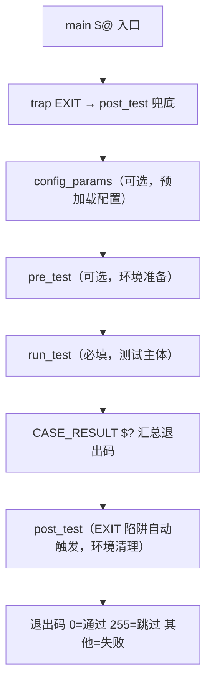
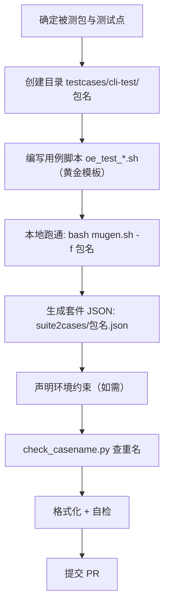

# 10 新用例与新测试套贡献指南

> 本章写给想向 mugen 仓库贡献新用例/新测试套的开发者：先讲**框架怎么用**（必备 API），再给**命名与检视规范**（仓库 `doc/测试用例检视规范.md` 的权威要求），最后是**完整实操流程**（从建目录到提交 PR）。全部基于框架源码与规范原文，无虚构。

## 1. 先懂三件事：用例生命周期、黄金模板、公共 API

### 1.1 用例生命周期（框架自动执行）



> **关键**：`post_test` 由 EXIT 陷阱自动执行（不依赖用例显式调用），用例中途 `exit` 也会触发清理。所以 `post_test` **不要**写在 run_test 里手动调用。

### 1.2 黄金模板（全库 {{CHECK_CASES}} 个含断言用例的通用结构）

```bash
#!/usr/bin/bash
# Copyright (c) 2025 Huawei Technologies Co.,Ltd.ALL rights reserved.  # 年份=当前年
# @Desc: xxx test                                                            # 英文描述
source "${OET_PATH}/libs/locallibs/common_lib.sh"      # 框架公共库（自动选 python/shell 实现）

function pre_test() {                                  # 环境准备（不能有 CHECK_RESULT）
    LOG_INFO "Start environmental preparation."
    DNF_INSTALL "被测包"                               # 装包，自动记录依赖供 post_test 回滚
    LOG_INFO "End of environmental preparation!"
}

function run_test() {                                  # 测试主体
    LOG_INFO "Start testing..."
    cmd_under_test 参数
    CHECK_RESULT $? 0 0 "错误时的易理解英文日志"
    cmd_under_test 参数2
    CHECK_RESULT $? 0 0 "错误时的易理解英文日志"
    LOG_INFO "Finish test!"
}

function post_test() {                                 # 环境清理（不能有 CHECK_RESULT）
    LOG_INFO "start environment cleanup."
    DNF_REMOVE                                           # 与 DNF_INSTALL 配对，可省略参数
    rm -rf /tmp/测试临时目录                              # 清理临时文件
    LOG_INFO "Finish environment cleanup!"
}

main "$@"
```

### 1.3 必会公共 API（详见 02 章，此处速查）

| API | 用法 | 说明 |
|-----|------|------|
| `CHECK_RESULT` | `CHECK_RESULT 实际 期望 [mode] [日志] [exit_mode]` | mode=0 不相等即错；mode=1 相等即错（反向/预期失败）；必带 4 参数 |
| `DNF_INSTALL` | `DNF_INSTALL "包1 包2"` | 一次装多个；包不存在自动 `exit 255` 跳过；冲突 `exit 247` |
| `DNF_REMOVE` | `DNF_REMOVE` | 回滚 DNF_INSTALL 装的所有依赖 |
| `LOG_INFO/WARN/ERROR` | `LOG_INFO "消息"` | 日志（stderr + 时间戳） |
| `P_SSH_CMD` | `P_SSH_CMD --node 2 --cmd "..."` | paramiko 远端执行（多机/嵌入式首选） |
| `SSH_CMD` | `SSH_CMD "cmd" $NODE2_IPV4 $NODE2_PASSWORD $NODE2_USER` | expect 封装 SSH（降级路径） |
| `SFTP` | `SFTP put --node 2 --localdir ... --remotedir ...` | 文件/目录传输 |
| `TEST_NIC` / `TEST_DISK` | `TEST_NIC 1` / `TEST_DISK 1` | 取可用网卡 / 未挂载磁盘（破坏性存储测试用） |
| `GET_FREE_PORT` | `GET_FREE_PORT $NODE2_IPV4 1000 10000` | 取空闲端口 |
| `REMOTE_REBOOT` | `REMOTE_REBOOT 2 300` | 重启远端节点并等待 |
| `SLEEP_WAIT` | `SLEEP_WAIT 5` | 等待（超时/轮询） |
| `EXECUTE_T` | 用例顶部 `EXECUTE_T="90m"` | 覆盖默认 30m 超时（长任务） |
| 节点变量 | `$NODE<id>_IPV4/_PASSWORD/_USER/_SSH_PORT/...` | 读取 conf/env.json 注入的环境变量 |

## 2. 命名与检视规范（仓库权威要求，逐条执行）

### 2.1 用例命名（`doc/测试用例检视规范.md` 原文要点）

| 规则 | 格式 |
|------|------|
| 基本命名 | `oe_test_包名.sh` / `oe_test_包名_序号.sh` / `oe_test_包名_命令.sh` |
| 命令参数 >10 个 | 拆分：`oe_test_包名_命令1_序号.sh` |
| 多命令且总参数 <10 | 可合并为 `oe_test_包名_序号.sh`（描述中说明覆盖的命令） |
| 多命令参数均 <3 | 建议合并进一个用例 |
| 多版本差异 | `oe_test_rpm包名_base_命令`（基线）+ `_version1_命令`/`_version2_命令`，套件 JSON 对应 `源码包名_version1.json` / `_version2.json` |

> 包名=被测软件包名；序号=01, 02, ...；**一个用例一个文件**，位于 `testcases/<域>/<源码包名>/`。

### 2.2 检视规范硬性要求（PR 合入前必须满足）

| 类别 | 要求 |
|------|------|
| 注释/描述 | 必须**英文**；文件头年份=当前年份 |
| 覆盖度 | 被测包命令和参数**全部覆盖**；每个命令参数都要校验结果 |
| 结构 | `config_params` 只放预加载数据；`pre_test` 只放预置；`run_test` 只放测试；`post_test` 只放清理（必须清理完全） |
| 禁止 | `pre_test/post_test` 内**不得有 CHECK_RESULT**；用例体不得出现 `python xx` 执行命令 |
| 独立性 | 每个用例独立，互不依赖、互不影响 |
| 命令细节 | `mv` 必须 `-rf`；`cp` 必须 `-f`；`userdel` 加 `-rf`；临时文件放 `/tmp` 或当前路径临时目录并在 post_test 清理 |
| 归并 | 能归并的语句归并（多个 `rm` 合并一个） |
| 复用 | 尽量用框架公共变量/方法（`NODE1_XX` 系列）；用例辅助文件放当前路径 `common/` 目录（>20 个打包上传） |
| 格式化 | 函数体缩进 4 空格；命令参数/特殊符号前后一个空格；`test -f file` 判存在；`grep xxx file` 查关键词；`cmd 2>&1 \| grep xxx` 看 stderr |
| 代码质量 | 不定义从不使用的变量；不写无意义代码；无重复代码；尽量相对路径；无逻辑性错误 |
| 提交要求 | 必须有**用例执行结果截图**；文件必须格式化；按 PR 意见修改后**必须回复**（无需修改也给出理由），合入需附整个测试套跑通截图 |

## 3. 新增一个测试套（完整流程）



### 3.1 目录与套件 JSON

```
testcases/cli-test/包名/
    oe_test_包名.sh            # 用例脚本
    common/                    # 辅助文件（如有）
suite2cases/包名.json          # 套件注册清单
```

```json
// suite2cases/包名.json
{
  "path": "$OET_PATH/testcases/cli-test/包名",
  "cases": [
    {"name": "oe_test_包名"},
    {"name": "oe_test_包名_01"}
  ]
}
```

### 3.2 声明环境约束（可选项，写入套件 JSON 顶层）

```json
{
  "path": "...",
  "machine num": 2,                  // 需要 2 台机器
  "machine type": "physical",        // 仅物理机
  "add disk": [10],                  // 需要 10G 空闲盘
  "add network interface": 1,        // 需要 1 个额外网卡
  "cases": [...]
}
```

> 约束在用例执行前由 `check_environment.py` 校验，不满足自动 **skipped(255)**，不会误报失败。多机用例内用 `P_SSH_CMD --node 2` 与 `$NODE2_*` 变量操作第二台机器。

### 3.3 本地验证命令

```bash
# 跑单个用例（-f 套件 -r 用例）
bash mugen.sh -f 包名 -r oe_test_包名
# 跑整个套件
bash mugen.sh -f 包名
# 查套件/用例名是否重复（仓库根目录）
python3 check_casename.py
# 检查结果
# results/包名/succeed|failed|skipped/用例名
# logs/包名/用例名/<时间戳>.log
```

## 4. 新增一个测试套（多版本变体，针对同一包不同版本）

按检视规范的"多版本"结构：

```
testcases/cli-test/源码包名/
    oe_test_rpm包名_base_命令.sh     # 多版本共用的基线用例
    oe_test_rpm包名_v1_命令.sh       # 版本 v1 特有
    oe_test_rpm包名_v2_命令.sh       # 版本 v2 特有
suite2cases/源码包名_v1.json         # 引用 base + v1 用例
suite2cases/源码包名_v2.json         # 引用 base + v2 用例
```

> 仓库实例如 `389-ds-base`（+`389-ds-base_1.4.3.20`）、`criu`（+`3.15`/`3.16`）、`hwloc`（+`1.11.9`）。

## 5. 新增嵌入式用例（可选进阶）

嵌入式用例在 `testcases/embedded-test/`，每个用例一个**同名目录**：
```
testcases/embedded-test/os_basic_tests/oe_test_basic_cmd_ls/oe_test_basic_cmd_ls.sh
```
- 通过 `combination/*.json` 组合矩阵在 QEMU/板卡上执行（见 04 章）；
- 交叉编译类用例依赖 `SDK_PATH`（组合环境生成，见 04/05 章）；
- 依赖 QEMU 环境时先 `bash dep_install.sh -e` 装 QEMU 依赖。

## 6. 提交 PR（合规流程）

1. **代码规范**：提交信息遵循 openEuler Embedded 规范（含 DCO 签名 `Signed-off-by`）；格式化、去重检查完成；
2. **自检清单**（对照 2.2 逐条）：
   - [ ] 有执行结果截图（单用例 + 整套件）
   - [ ] 英文注释、当前年份
   - [ ] 无 `pre_test/post_test` 内 CHECK_RESULT
   - [ ] 命令参数全覆盖且有校验
   - [ ] post_test 清理完全
   - [ ] `check_casename.py` 通过
3. **PR 提交流程**：推送到个人 fork → 提交 PR 到上游仓库 → 按检视意见逐条回复修改（无需修改也给理由）→ 合入前补整套件跑通截图。

## 7. 常见坑位（来自全库代码扫描，避免新用例踩坑）

| 坑 | 正确做法 |
|----|----------|
| `ret=SSH_CMD ...` 没取返回值 | `ret=$(SSH_CMD ...)` 命令替换 |
| 间接引用写成 `$[ "NODE"$node"_LOCATION" ]` | 用 `eval`/`${!var}`（见 02 章问题） |
| `for i in seq 100`（字面量） | `for i in $(seq 100)` |
| 用例注册了但脚本不存在 | 提交前确保 suite2cases 与 testcases 一一对应（当前 {{MISSING_CASES}} 例缺失，见 11 章） |
| 脚本存在但未注册（孤儿） | 套件 JSON 必须引用所有正式用例（当前 {{ORPHANS}} 个孤儿脚本，见 11 章） |
| 命令参数写死绝对路径 | 用相对路径或 `$(cd "$(dirname "$0")" ...; pwd)` |
